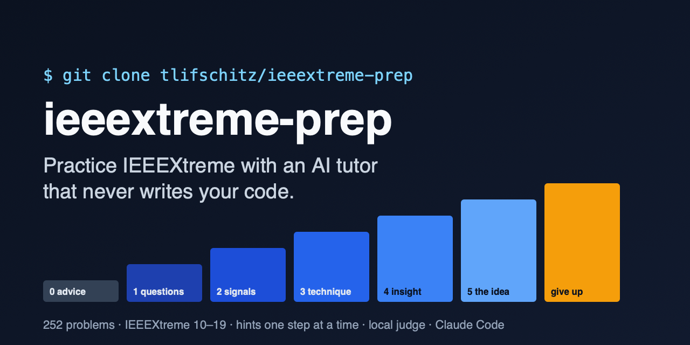

<p align="center">
  
</p>

<p align="center">
  <a href="https://github.com/tlifschitz/ieeextreme-prep/actions/workflows/ci.yml"></a>
  <a href="LICENSE"></a>
  
  
  <a href="https://docs.claude.com/en/docs/claude-code/overview"></a>
</p>

# ieeextreme-prep

**Practice for [IEEEXtreme](https://ieeextreme.org/) with an AI tutor that never writes your code.**

The 252 problems of the CS Academy IEEEXtreme practice archive (editions 10 to 19), a local judge,
a contest library in Python and C++, and a [Claude Code](https://docs.claude.com/en/docs/claude-code/overview)
tutor that coaches you through competitive programming problems the way a good coach would: with
questions first, then hints one step at a time, and only when you ask for them.

## Why

Reading a solution teaches you that solution. Getting stuck, being nudged and finding it yourself
teaches you how to recognize the next one. Most competitive programming repositories hand you the
answer; this one is built around the friction that makes practice work:

- **The tutor never writes, shows or paraphrases solution code.** Not pseudocode, not "just the main
  loop", not a fixed version of your function. The implementation is always yours.
- **Hints come on a ladder, one step per consent.** Step 0 is general advice for any problem; then
  questions about the statement and the limits, what to look at, the technique, the key insight,
  and the idea of each solution level in prose. The tutor asks before every step up, and "give me a
  hint" gets help within the step you are on, not the next one.
- **Solutions are there, but not by accident.** Each problem's solutions, ladder and notes are packed
  in an obfuscated `spoiler.bin`: not encryption, just enough to keep you from reading them by
  accident.
- **Giving up leaves a record.** Seeing a solution means running one command yourself, which commits
  a line to `progress/give-ups.md` first. Honest practice includes knowing what you could not solve.
- **Learn techniques, not just problems.** Pick a topic ("I want to learn the contribution
  technique") and get curated reading (book chapters and sections, papers, cp-algorithms, the USACO
  Guide, CSES), then the archive's problems of that technique, easy to hard.

## Demo

<p align="center"></p>

A live session, recorded with [VHS](https://github.com/charmbracelet/vhs) from [`assets/demo.tape`](assets/demo.tape);
only the tutor's thinking time is cut.

## Quick start

```bash
git clone https://github.com/tlifschitz/ieeextreme-prep.git
cd ieeextreme-prep
claude    # Claude Code
```

Then just talk to it, in any language:

> I want to practice Brick stacks.
>
> Quiero aprender programación dinámica.
>
> I'm stuck. · Is my solution right? · I give up.

The first time you open the repository, accept Claude Code's workspace trust dialog: until you do,
it ignores `.claude/settings.json`, which lets the tutor's skills (`/practice`, `/hint`, `/verify`,
`/learn`, `/give-up`) run without asking for permission each time.

## Practicing without Claude Code

Everything except the conversation works on its own (Python 3.10+, and a C++17 compiler for C++):

```bash
python3 scripts/verify.py --setup        # checks Python, numpy and the C++ compiler
cp templates/attempt/attempt.py "contests/ieeextreme18/Brick stacks/"
python3 scripts/verify.py "Brick stacks" # runs your attempt against the local tests, like a judge
python3 scripts/bundle.py my_solution.py -o submit.py   # inlines lib/ into one submittable file
```

Each `contests/ieeextremeNN/<problem>/PROBLEM.md` links to the problem on CS Academy, where you
submit to the real judge.

## What's inside

| Path | What it is |
|---|---|
| `contests/ieeextremeNN/<problem>/` | `PROBLEM.md` (statement and CS Academy link), images, sample input, `spoiler.bin` |
| `contests/.../tests/` | curated local tests, with stress and adversarial cases, for the 55 practice problems |
| `data/practice.json` | the catalog: problems with tutoring and tests (`practice`) and problems with a statement and a spoiler only (`archive`) |
| `data/references.json` | curated reading per technique: book sections, papers, web pages, practice problems |
| `lib/` | a contest library (graphs, trees, DP, data structures, strings, number theory, geometry, FFT/NTT...) in Python and C++, with tests |
| `scripts/` | `verify.py` (local judge), `reveal.py` (hints, give-up), `bundle.py`, `tutor_state.py`, `tutor_catalog.py` |
| `CLAUDE.md`, `.claude/skills/` | the tutor: its rules, the ladder, the disclosure budget and the skills |

## How it works

- **The ladder lives inside the spoiler.** Every practice problem has hints written per step
  (`hints.json`, packed in its `spoiler.bin`). The tutor asks `reveal.py --hint <problem> --step N`
  for exactly the step you accepted, so it never sees, and cannot leak, the steps above.
- **The tutor keeps a log, locally.** `tutor_state.py` records offers, answers, hints, verifications
  and reading in `.tutor/` (git-ignored), and refuses inconsistent entries: a hint for a step you did
  not accept, or an offer for a step the problem does not have. That is how it resumes "yesterday's
  problem" without repeating itself.
- **A local judge.** `verify.py` compiles once and reports each test like a contest judge (OK, WA,
  RE, TLE, CE), with checkers for problems that accept several answers and an interactor for the
  interactive one. Local tests are not the judge's: passing them all is not a score.
- **Giving up is a transaction.** `reveal.py <problem>` decodes the spoiler, checks that nothing of
  yours would be overwritten, commits the record, then installs the solution, the levels from naive
  to optimal, and the notes.
- **Generated, not hand-edited.** This repository is published from a private maintenance repository:
  every publication is checked for leaks and pinned to its source, and CI verifies that every
  published solution passes every published test.

## Giving up

Solve the problem first. If you decide to see the solution:

```bash
python3 scripts/reveal.py "<problem>"
```

It records the give-up in `progress/give-ups.md` (a commit in your clone), then installs the
solution, the levels and the notes into the problem folder. `reveal.py` never pushes, but if you
push your clone or fork, your give-ups go with it, and that is on purpose: the record is part of
practicing honestly. It never overwrites your own `attempt.py` / `attempt.cpp`.

## Contributing

Wrong tests, hints that give away too much, tutor misbehavior, broken references, library bugs:
see [CONTRIBUTING.md](CONTRIBUTING.md). Please never post solutions in issues.

## License, attribution and disclaimer

The code, the tutor, the tests, the hints and the rest of the material written for this repository
are under the [MIT license](LICENSE).

The problem statements, images and sample tests come from the IEEEXtreme Programming Competition
(IEEE) as published in the [CS Academy IEEEXtreme practice archive](https://csacademy.com/ieeextreme-practice/tasks).
They belong to their authors and are included here only as practice material.

This is an independent project. It is not affiliated with, endorsed by or sponsored by IEEE,
IEEEXtreme, CS Academy or Anthropic. IEEEXtreme is a trademark of IEEE.
