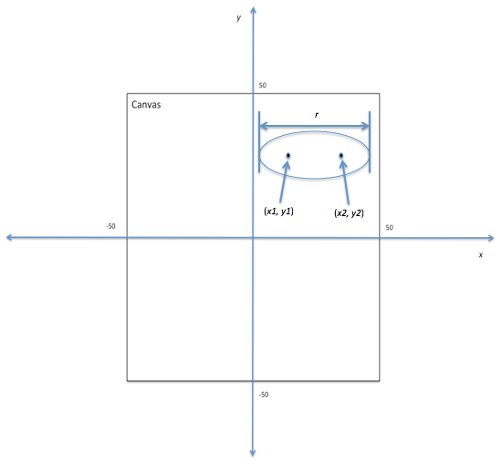

# Ellipse Art

**IEEEXtreme 10.0** · Time limit: 2000 ms · Memory limit: 512 MB

**CS Academy:** <https://csacademy.com/ieeextreme-practice/task/ellipse-art/>

In IEEEXtreme 9.0, you met the famous artist, I.M. Blockhead.  This year we want to introduce you to another famous artist, Ivy Lipps.  Unlike I.M., Ivy makes her art by painting one or more ellipses on a canvas.  All of her canvases measure $100$ by $100$ cms.

She needs your help.  When she is done with the painting, she would like to know how much of the canvas is unpainted.

## Standard input

The first line of input contains $t$, which gives the number of test cases.

Each test case begins with a single integer $n$, which indicates the number of ellipses that Ivy has drawn.

The following *n* lines give the dimensions of each ellipse, in the following format: $x_1\ y_1\ x_2\ y_2\ r$

Where:

- $(x_1, y_1)$ and $(x_2, y_2)$ are positive integers representing the location of the foci of the ellipse in cms, considering the center of the canvas to be the origin, as in the image below.
- $r$ is a positive integer giving the length of the ellipse's major axis.

You can refer to [the Wikipedia webpage for background information on ellipses](https://en.wikipedia.org/wiki/Ellipse).



/Coordinate system for the canvas./

## Standard output

For each test case, output to the nearest percent, the percent of the canvas that is unpainted.

The output should be rounded to the nearest whole number. If the percent of the canvas that is unpainted is not a whole number, you are guaranteed that the percent will be at least $10\%$ closer to the nearer percent than it is from the second closest whole percent. Therefore you will not need to decide whether a number like $23.5\%$ should be rounded up or rounded down.

## Constraints and notes

- $1 \leq t \leq 8$
- $1 \leq n \leq 40$
- $-100 \leq x_1, y_1, x_2, y_2 \leq 100$
- $r \leq 200$
- $r \geq \sqrt{(x_2 - x_1)^2 + (y_2 - y_1)^2} + 1$

## Examples

### Example 1

Input:
```
3
1
-40 0 40 0 100
1
10 50 90 50 100
2
15 -20 15 20 50
-10 10 30 30 100
```

Output:
```
53%
88%
41%
```

Explanation:

The ellipse in the first test case falls completely within the canvas, and it has an area of approximately $4,712$ cm$^2$.  Since the canvas is $10,000$ cm$^2$, $53\%$ of the canvas is unpainted.

In the second test case, the ellipse has the same size as in the first, but only one quarter of the ellipse is on canvas. Therefore, $88\%$ of the canvas is unpainted.

In the final testcase, the ellipses overlap, and $41\%$ of the canvas is unpainted.
