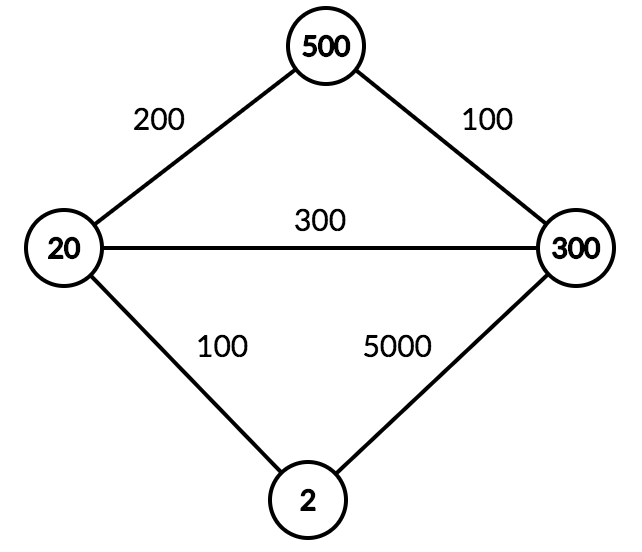

# Collecting Gold

**IEEEXtreme 11.0** · Time limit: 2000 ms · Memory limit: 256 MB

**CS Academy:** <https://csacademy.com/ieeextreme-practice/task/333043935273ab966569971859d1835b/>

Ariadne is the queen of Knossos in Crete and she is the ruler of all the cities and villages in the Mediterranean basin. Ariadne is in great need of gold. Her geographers put a *unique* /id/ on every city/village that represents the kilos of gold that can be extracted from that city/village. The /id/ is an integer $k$ ($1 \leq k \leq 10^{18}$  ). The kilos of gold for every city/village can be calculated from the /id/ as follows:

- Kilos = the number of unique consecutive prime numbers, starting from number $2$, such that their product is less or equal than the /id/ of the city/village

For example if the city /id/ is $40$ the kilos of gold that can be extracted is <Latex value="3"/> $(2 * 3 * 5 = 30 \leq 40)$.

Ariadne is sending a mission to collect the gold. The mission will start from the city/village with the smallest /id/ and will finish at the city/village with the biggest /id/, following one of the shortest routes between the two cities. The distance between two cities is given as it is described below in input.

There is always a route that connects the starting and finishing cities.

## Standard input

The first line contains two integers $n$ and $m$, where $n$ represents the number of cities/villages and $m$ the number of the connections between them.

Each of the next $n$ lines contains the /id/ of a city/village.

Each of the next $m$ lines contains three integers $x$, $y$, $d$ and represents the connection from $x$ to $y$ with distance $d$ . The connections are not directed.

## Standard output

One integer, the maximum kilos of gold that the mission can collect.

## Constraints

- $1 \leq n \leq 2 * 10^4$
- $0 \leq m \leq 2 * 10^4$
- $1 \leq k \leq 10^{18}$, all $k$ are unique
- $1 \leq x, y \leq 10^{18}$
- $0 \lt d \leq 10^{5}$

## Examples

### Example 1

Input:
```
4 5
500
2
300
20
2 300 5000
2 20 100
300 20 300
300 500 100
20 500 200
```

Output:
```
7
```

Explanation:

The cities are connected as follows.



The mission will follow the route $2$ -> $20$ -> $500$ and will collect, $1$ kilo from city $2$, $2$ kilos from city $20$ and $4$ kilos from city $500$. In total $7$ kilos.
