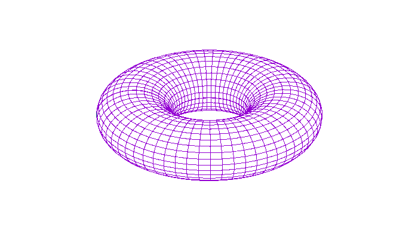

# Game of Life

**IEEEXtreme 11.0** · Time limit: 1200 ms · Memory limit: 128 MB

**CS Academy:** <https://csacademy.com/ieeextreme-practice/task/d12a7784af1a3d3f6d88601c81a4bb81/>

You are asked to make an implementation of the [game of life](https://en.wikipedia.org/wiki/Conway's_Game_of_Life) by John Horton Conway on a finite torus board and provide its output after $c$ iterations.



## Standard input

On the first line of the input there will be three integers $n$, $m$ ($1 \leq n, m \leq 25$) and $c$ ($1 \leq c \leq 10^7$). $n$ and $m$ give the size of the board and $c$ gives the number of iterations that you must simulate.

On the following $n$ lines there will be $m$ characters, either `*` or `-`, each one representing the value of each cell of the board. `*` represents a /populated/ cell and `-` an /unpopulated/ one.

Please note that the bottom neighbours of the last line are cells in the top line, and the left neighbours of the first column are the cells of the last column.

## Standard output

On the output there should be $n$ lines of $m$ characters each, which represent the state of the board after $c$ iterations.

## Constraints and notes

- $1 \leq n, m \leq 25$
- $1 \leq c \leq 10^7$

## Examples

### Example 1

Input:
```
4 6 3
------
------
------
-***--
```

Output:
```
--*---
------
--*---
--*---
```

### Example 2

Input:
```
5 6 1234
------
--*---
---*--
-***--
------
```

Output:
```
-----*
---*-*
----**
------
------
```

### Example 3

Input:
```
7 9 5
---------
---------
---------
--*****--
---------
---------
---------
```

Output:
```
----*----
---***---
--*-*-*--
-***-***-
--*-*-*--
---***---
----*----
```

### Example 4

Input:
```
4 6 1
-----*
--*---
*-----
-***-*
```

Output:
```
**-**-
------
*--*--
-**-**
```
