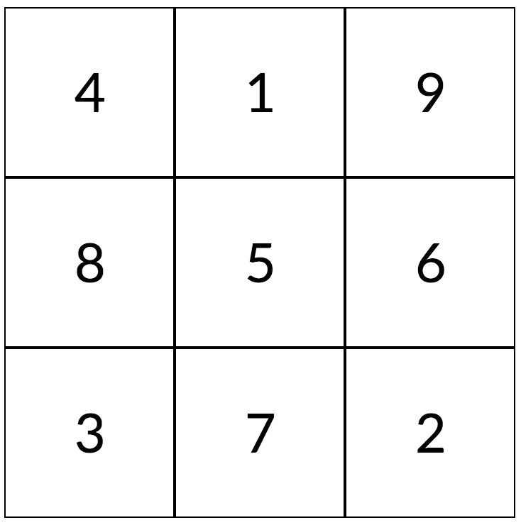
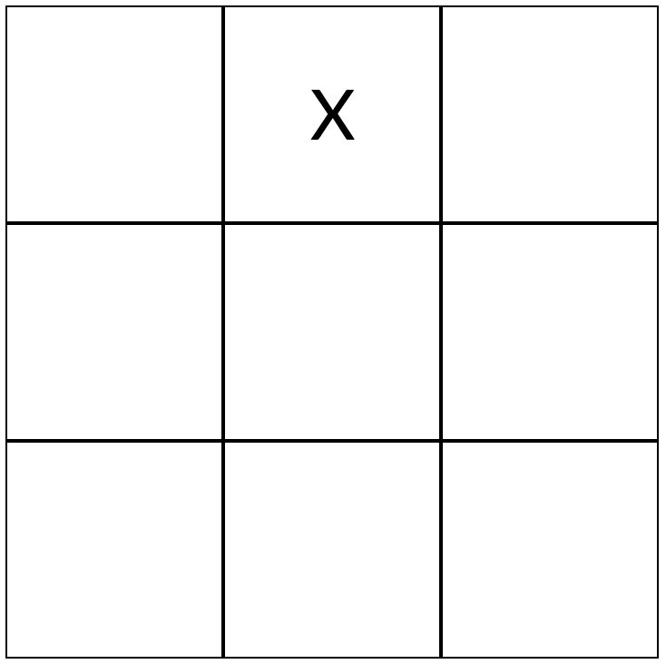
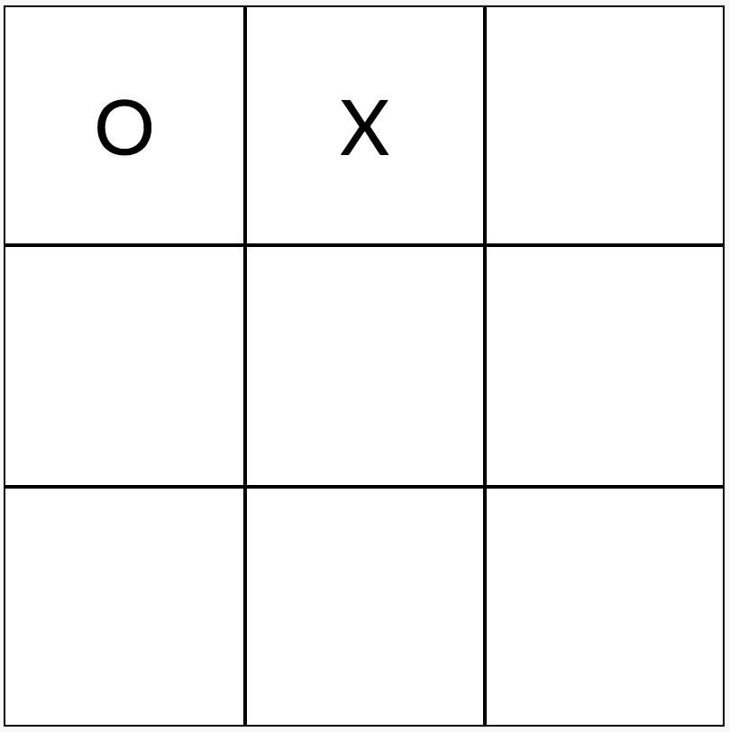
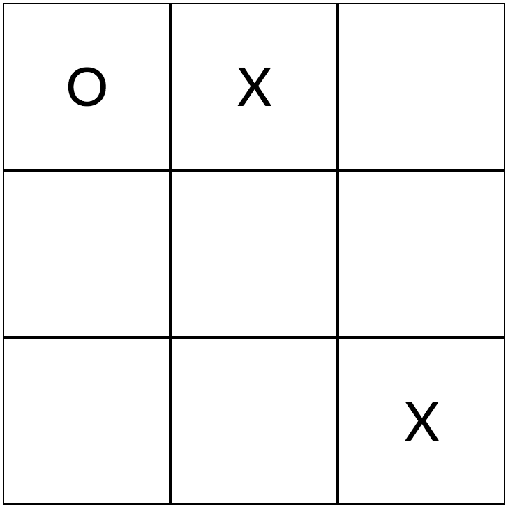
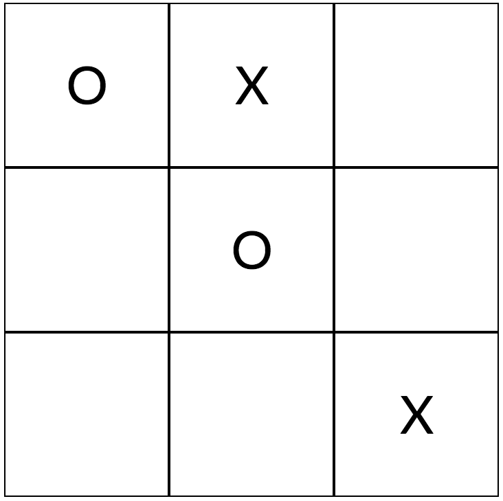
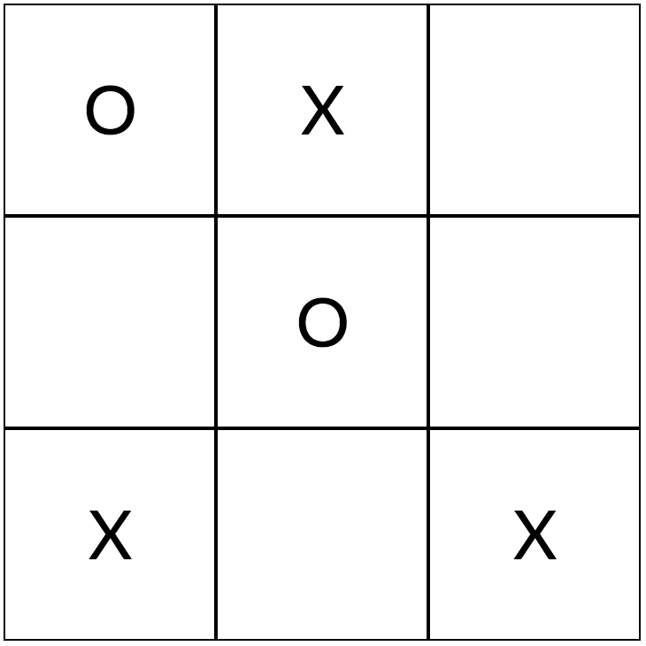
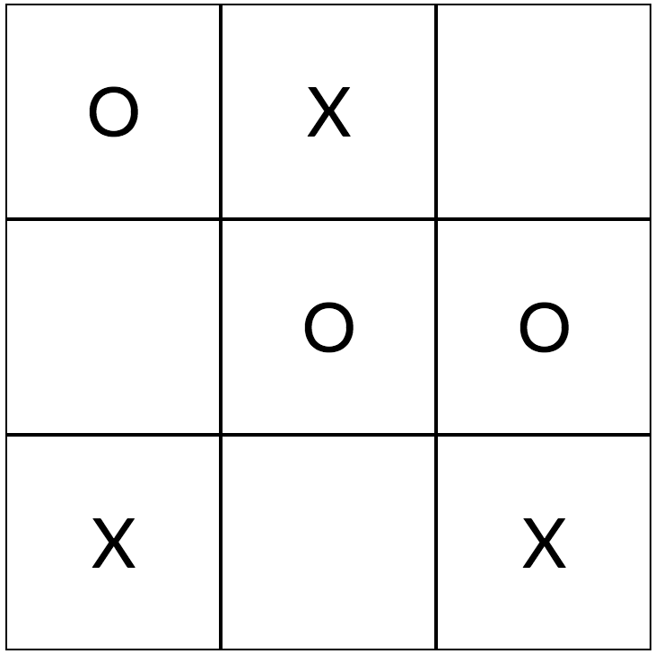
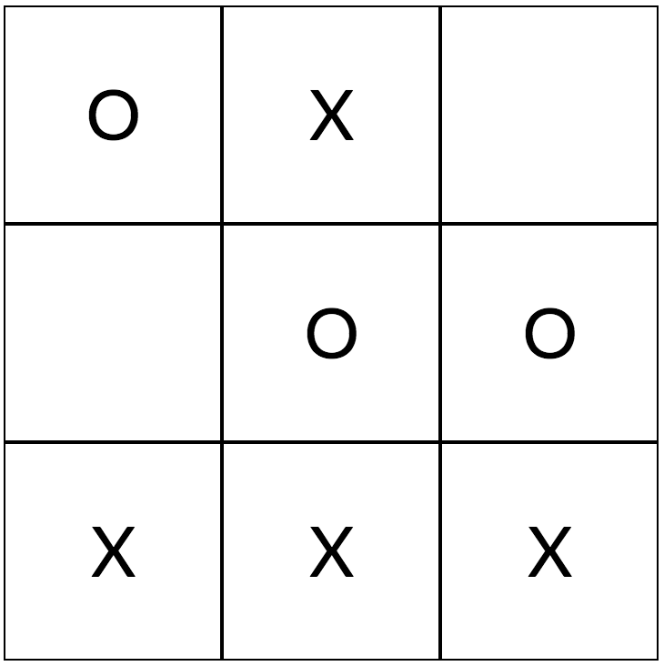

# Let’s Cheer Up Bob

**IEEEXtreme 11.0** · Time limit: 1000 ms · Memory limit: 128 MB

**CS Academy:** <https://csacademy.com/ieeextreme-practice/task/ca9bc49133da9c3c90df045f4ea8fdd3/>

Bob is the world’s worst [tic-tac-toe](https://en.wikipedia.org/wiki/Tic-tac-toe) player. He has never won a game. You, being a good friend, are determined to help him win his first game. You will insist that Bob makes the first move in the game.

In addition, you have noticed that Bob has been selecting squares in a methodical way. He has a definite preference order in which he selects squares. He chooses as his next square, the open square that is highest on his preference list. You will devise a list of moves that ensures, even with a really bad strategy, that Bob will be assured of a win.

From Wikipedia:  /Tic-tac-toe (also known as noughts and crosses or <Latex value="X"/>s and  <Latex value="O"/>s) is a paper-and-pencil game for two players, <Latex value="X"/> and <Latex value="O"/>, who take turns marking the spaces in a <Latex value="3\times3"/> grid. The player who succeeds in placing three of their marks in a horizontal, vertical, or diagonal row wins the game./

## Standard input

The input consists of nine lines with the preference list of Bob’s moves.  Each line contains a two integers giving the row and the column of the moves.  The rows and columns are numbers between $1$ and $3$, inclusive.

## Standard output

The output will consist of a list of turns that you will make to ensure that Bob wins in the fewest possible moves.  If at any point, you could make more than one move that would lead to a win for Bob in the fewest moves, you should choose the move that is in the lowest numbered row.  If there are multiple moves in the lowest numbered row, you should choose the one with the lowest numbered column.

## Constraints and notes

- The nine squares in the input are distinct

## Examples

### Example 1

Input:
```
1 2
3 3
3 1
1 1
2 2
2 3
3 2
2 1
1 3
```

Output:
```
1 1
2 2
2 3
```

Explanation:

The grid below gives the tic-tac-toe board with numbers reflecting Bob’s preferences (lower numbers mean higher preference.)



Bob always moves first, and on his first move, he chooses the square with preference 1.  If Bob is X’s, the board now looks like:



You choose the top left corner:



Bob’s highest remaining preference is 2, and the bottom corner is open, so after his second move, the board looks like:



You now take the middle:



Bob’s 3rd preference is still available, so he chooses the lower left corner:



You then move:



Bob’s most preferred remaining square is the bottom middle one, so he moves and wins:



Whew!  It is hard work making sure Bob wins, but that’s just the kind of friend you are.
