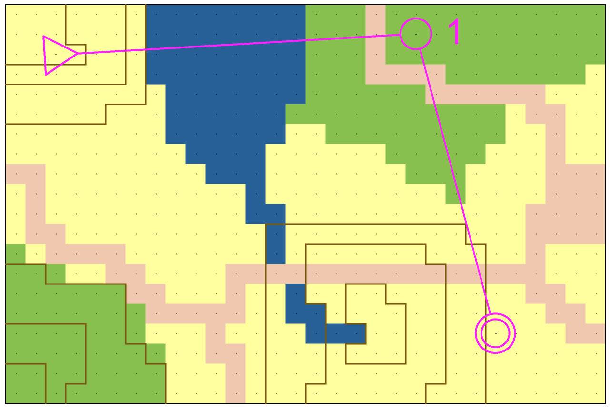
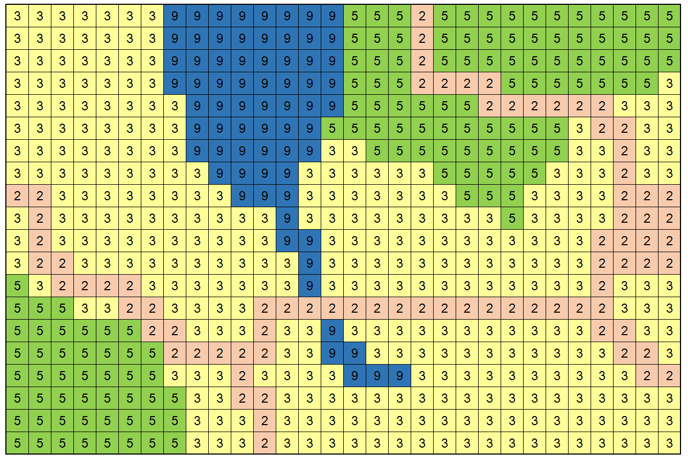
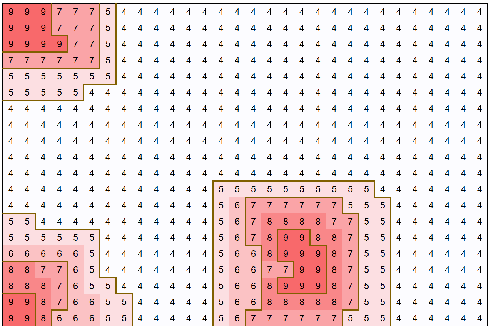
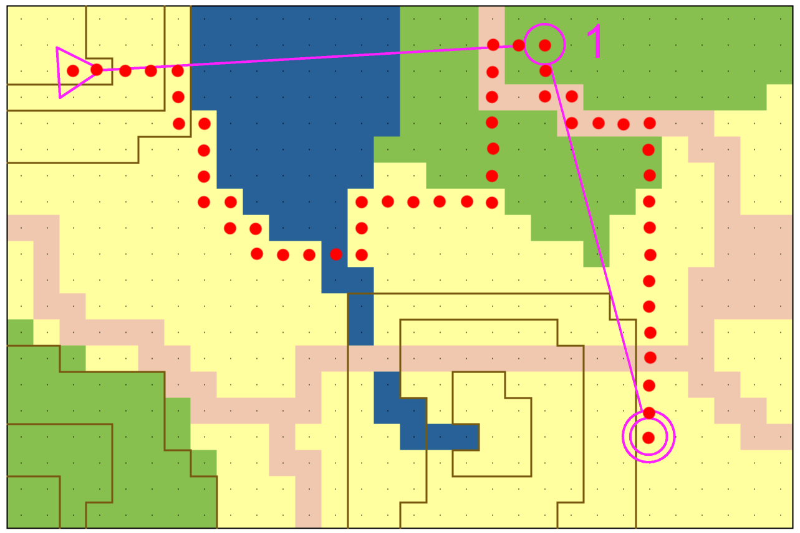

# Orienteering

**IEEEXtreme 11.0** · Time limit: 3000 ms · Memory limit: 128 MB

**CS Academy:** <https://csacademy.com/ieeextreme-practice/task/95352fd33b0e855d337b5b3ed85da3b6/>

[Orienteering](http://orienteering.org/about-orienteering/) is a wonderful outdoor sport in which participants are expected to reach a set of control points in the specified order. The path is not predetermined and each runner navigates by its own with the help of a detailed map and a compass. During the race, orienteers face multiple challenges, including: planning the best path from each control point to the following, navigating into the terrain to follow the desired path and to avoid getting lost, and running as fast as possible to beat other competitors.

In this challenge, you deal with path planning: given an orienteering map and a course, which is the best /route choice/? To answer this question consider a grid map representation: a uniform subdivision of the terrain into $10 \times 10$m squares called /tiles/. So, the course is a sequence of $p+1$ tiles in the grid: the starting tile and $p$ tiles in which control points are located.

---



Illustration 1 /An orienteering map with a course. The course is represented in purple and is composed by three points: the start (indicated with a triangle), the first control point (single circle) and the final control point (double circle). In the map can be recognized some terrain features: a small river and a marsh (in blue), streets (in pink), grass fields (yellow) and woods (green). Moreover, in the map are represented also three hills with contours (brown lines)./

---

In this context, the orienteering map is encoded with two matrices, representing terrain characteristics. The first matrix $r$ contains information about the type of terrain and in particular its runnability: for example, a grass field has a better runnability than a marsh. In this matrix, values are proportional to the expected crossing time of tiles, so smaller values indicate better runnability. The second matrix $h$ is the digital elevation model (DEM) of the terrain: element values represent tile’s altitudes.

---





Illustration 2 /Map representation as two matrices: the runnability matrix (up) and the elevation matrix (down). Note that the runnability of the streets (2) is better than other types of terrain, for example runnability of marshes is 9./

---

The travel time for moving from a tile to a neighboring tile depends on two factors: (i) the runnability of both tiles and (ii) the slope of the terrain, i.e., the difference in elevation of the tiles. In particular,  the travel time follows the [Tobler's hiking function](https://en.wikipedia.org/wiki/Tobler%27s_hiking_function), which is commonly used to determine the hiking speed taking into account the slope angle. In details, the travel time $t$ from tile $a$ to a neighbour tile $b$ can be computed as follows: $\large{t=\frac{r_{a}+r_{b}}{2}*e^{3.5|\frac{h_{b}-h_{a}}{10}+0.05|}}$, where $r_{x}$ and $h_{x}$ are the runnability and the elevation of the generic tile $x$, respectively.

To plan the path, consider tiles as $4$-connected: a tile at the $i^{th}$ row and $j^{th}$ column of the matrix is a neighbour of at most $4$ tiles: the tile at north $(i-1, j)$ if it exists, the tile at south $(i+1, j)$, the tile at east $(i, j+1)$ and the tile at west $(i, j-1)$. So, it is not possible in a path to have diagonal steps.

## Task

Your task is to find the minimum time required to complete the course, which corresponds to the travel time of the best path. Remember that control points must be visited in the given sequence, and they can appear in the course more than once. In case a control point appears more than once in the course, it must be visited more than once.

## Standard input

The first line contains two integers separated by a blank space: the number of rows $n$ and the number of columns $m$ of the map ($1 \leq n, m \leq 600$).

The second line contains a single integer $p$ ($1 \leq p \leq 30$), which is the number of control points of the orienteering course. The last control point is the finish of the course.

The third line contains the starting point as two integers $i$, $j$ separated by a blank space for representing the $i^{th}$ row and the $j^{th}$ column of the grid ($0 \leq i < n$ and $0 \leq j < m$).

The following $p$ lines contain the positions of the control points, including the finish. The same representation as the one for the starting point is used. Note that the same position can appear more than once in the course.

The following $n$ lines represent the runnability matrix and contain $m$ rational numbers each. Numbers are separated by a blank space and use the /dot/ as separator of the decimal part ($0 \lt r_{i,j} \leq 9,999.99$).

The following $n$ lines represent the elevation matrix and have the same structure of the previous matrix; elevation is expressed in meters ($0 \leq h_{i,j} \leq 8,848.00$).

## Standard output

Print a single integer representing the travel time for completing the course. Rounding by ceiling is required if the resulting travel time is not an integer.

## Constraints and notes

- $1 \leq n, m \leq 600$
- $1 \leq p \leq 30$
- $0 \lt r_{i,j} \leq 9,999.99$
- $0 \leq h_{i,j} \leq 8,848.00$

## Examples

### Example 1

Input:
```
1 3
2
0 0
0 2
0 0
5.0 6.0 5.0
100.0 101.5 103.0
```

Output:
```
38
```

### Example 2

Input:
```
20 30
2
2 2
1 20
16 24
3 3 3 3 3 3 3 9 9 9 9 9 9 9 9 5 5 5 2 5 5 5 5 5 5 5 5 5 5 5
3 3 3 3 3 3 3 9 9 9 9 9 9 9 9 5 5 5 2 5 5 5 5 5 5 5 5 5 5 5
3 3 3 3 3 3 3 9 9 9 9 9 9 9 9 5 5 5 2 5 5 5 5 5 5 5 5 5 5 5
3 3 3 3 3 3 3 9 9 9 9 9 9 9 9 5 5 5 2 2 2 2 5 5 5 5 5 5 5 3
3 3 3 3 3 3 3 3 9 9 9 9 9 9 9 5 5 5 5 5 5 2 2 2 2 2 2 3 3 3
3 3 3 3 3 3 3 3 9 9 9 9 9 9 5 5 5 5 5 5 5 5 5 5 5 3 2 2 3 3
3 3 3 3 3 3 3 3 9 9 9 9 9 9 3 3 5 5 5 5 5 5 5 5 5 3 3 2 3 3
3 3 3 3 3 3 3 3 3 9 9 9 9 3 3 3 3 3 3 5 5 5 5 5 3 3 3 2 3 3
2 2 3 3 3 3 3 3 3 3 9 9 9 3 3 3 3 3 3 3 5 5 5 3 3 3 3 2 2 2
3 2 3 3 3 3 3 3 3 3 3 3 9 3 3 3 3 3 3 3 3 3 5 3 3 3 3 2 2 2
3 2 3 3 3 3 3 3 3 3 3 3 9 9 3 3 3 3 3 3 3 3 3 3 3 3 2 2 2 2
3 2 2 3 3 3 3 3 3 3 3 3 3 9 3 3 3 3 3 3 3 3 3 3 3 3 2 2 2 2
5 3 2 2 2 2 3 3 3 3 3 3 3 9 3 3 3 3 3 3 3 3 3 3 3 3 2 3 3 3
5 5 5 3 3 2 2 3 3 3 3 2 2 2 2 2 2 2 2 2 2 2 2 2 2 2 2 3 3 3
5 5 5 5 5 5 2 2 3 3 3 2 3 3 9 3 3 3 3 3 3 3 3 3 3 3 2 2 3 3
5 5 5 5 5 5 5 2 2 2 2 2 3 3 9 9 3 3 3 3 3 3 3 3 3 3 3 2 2 3
5 5 5 5 5 5 5 3 3 3 2 3 3 3 3 9 9 9 3 3 3 3 3 3 3 3 3 3 2 2
5 5 5 5 5 5 5 5 3 3 2 2 3 3 3 3 3 3 3 3 3 3 3 3 3 3 3 3 3 3
5 5 5 5 5 5 5 5 3 3 3 2 3 3 3 3 3 3 3 3 3 3 3 3 3 3 3 3 3 3
5 5 5 5 5 5 5 5 3 3 3 2 3 3 3 3 3 3 3 3 3 3 3 3 3 3 3 3 3 3
9 9 9 7 7 7 5 4 4 4 4 4 4 4 4 4 4 4 4 4 4 4 4 4 4 4 4 4 4 4
9 9 9 7 7 7 5 4 4 4 4 4 4 4 4 4 4 4 4 4 4 4 4 4 4 4 4 4 4 4
9 9 9 9 7 7 5 4 4 4 4 4 4 4 4 4 4 4 4 4 4 4 4 4 4 4 4 4 4 4
7 7 7 7 7 7 5 4 4 4 4 4 4 4 4 4 4 4 4 4 4 4 4 4 4 4 4 4 4 4
5 5 5 5 5 5 5 4 4 4 4 4 4 4 4 4 4 4 4 4 4 4 4 4 4 4 4 4 4 4
5 5 5 5 5 4 4 4 4 4 4 4 4 4 4 4 4 4 4 4 4 4 4 4 4 4 4 4 4 4
4 4 4 4 4 4 4 4 4 4 4 4 4 4 4 4 4 4 4 4 4 4 4 4 4 4 4 4 4 4
4 4 4 4 4 4 4 4 4 4 4 4 4 4 4 4 4 4 4 4 4 4 4 4 4 4 4 4 4 4
4 4 4 4 4 4 4 4 4 4 4 4 4 4 4 4 4 4 4 4 4 4 4 4 4 4 4 4 4 4
4 4 4 4 4 4 4 4 4 4 4 4 4 4 4 4 4 4 4 4 4 4 4 4 4 4 4 4 4 4
4 4 4 4 4 4 4 4 4 4 4 4 4 4 4 4 4 4 4 4 4 4 4 4 4 4 4 4 4 4
4 4 4 4 4 4 4 4 4 4 4 4 4 5 5 5 5 5 5 5 5 5 5 4 4 4 4 4 4 4
4 4 4 4 4 4 4 4 4 4 4 4 4 5 6 7 7 7 7 7 7 5 5 5 4 4 4 4 4 4
5 5 4 4 4 4 4 4 4 4 4 4 4 5 6 7 8 8 8 8 7 7 5 5 4 4 4 4 4 4
5 5 5 5 5 5 4 4 4 4 4 4 4 5 6 7 8 9 9 8 8 7 5 5 4 4 4 4 4 4
6 6 6 6 6 5 4 4 4 4 4 4 4 5 6 6 8 9 9 9 8 7 5 5 4 4 4 4 4 4
8 8 7 7 6 5 4 4 4 4 4 4 4 5 6 6 7 7 9 9 8 7 5 5 4 4 4 4 4 4
8 8 8 7 6 5 5 4 4 4 4 4 4 5 6 6 8 9 9 9 8 7 5 5 4 4 4 4 4 4
9 9 8 7 6 6 5 5 4 4 4 4 4 5 6 6 8 8 8 8 8 7 5 5 4 4 4 4 4 4
9 9 8 6 6 6 5 5 4 4 4 4 4 5 6 7 7 7 7 7 7 5 5 5 4 4 4 4 4 4
```

Output:
```
204
```

## Explanation

In the first sample, there is a simple map with $1$ row and $3$ columns. The course starts at $(0, 0)$, has a control point at $(0, 2)$ and then returns to the starting position $(0, 0)$. Only one single path is possible in this case, so there is no route choice. Note that the path consist of four steps: $(0, 0)$ → $(0, 1)$, then $(0, 1)$ → $(0, 2)$, and then back $(0, 2)$ → $(0, 1)$, and $(0, 1)$ → $(0, 0)$. To compute the total travel time, we need to apply the given formula four times, one for each step, obtaining: $11.08$, $11.08$, $7.80$, and $7.80$. Note that the way back is faster because it is downhill. The expected output is given by the sum and the rounding by ceiling: $\text{ceil}(11.08+11.08+7.80+7.80) = \text{ceil}(37.76) = 38$.

In the second sample, input encodes illustrations of the problem statement. Note that, in the illustration of the matrices, values are depicted as integer, while in the input the dotted format for rational numbers is used. One of the best paths for completing the given course is represented in the following illustration:



The total travel time of the path can be computed step by step applying the given formula for neighbour tiles. It results to be equal to about $203.12$. So, the desired solution is the ceiling value: $204$. Note that in this case other paths have an equivalent travel time of the given one, but it is the minimum.
