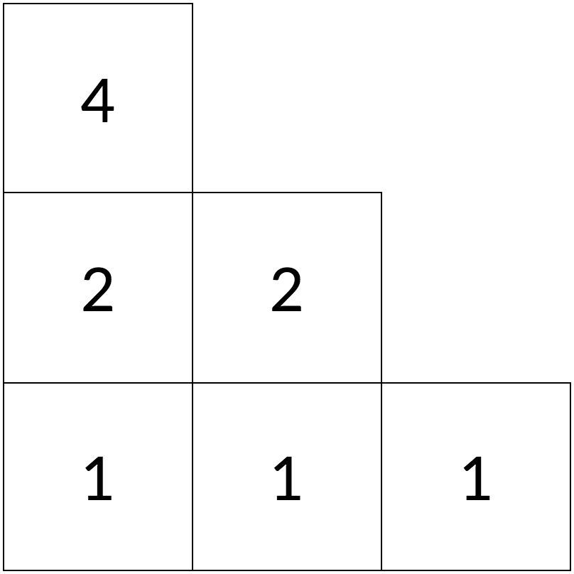
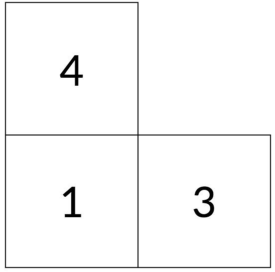
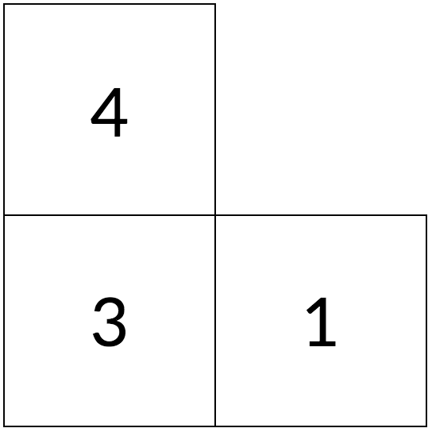
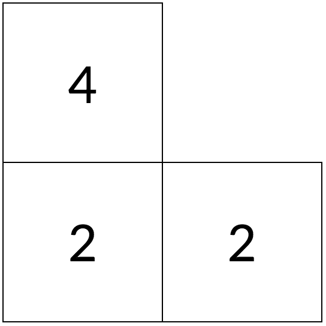
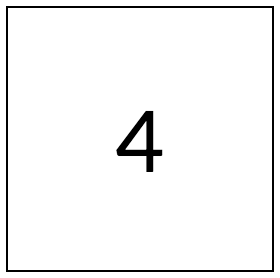

# Pyramid

**IEEEXtreme 11.0** · Time limit: 1000 ms · Memory limit: 128 MB

**CS Academy:** <https://csacademy.com/ieeextreme-practice/task/5e98e4b17b3477e671568a437388fb7a/>

A pyramid of numbers can be represented as a matrix $a$ of $n$ rows, where the $i^{th}$ row has elements only on the first $i$ columns. In addition,  $a_{i, j} = a_{i+1,j} + a_{i + 1,j+1}$, for the first $n-1$ rows. For the bottom row this doesn’t apply, those numbers can be any *strictly positive* integers.

Given an integer $s$, count the number of pyramids where $a_{1,1} = s$, for all possible values of $n$.

## Standard input

The first line contains integer $s$.

## Standard output

Print the number of pyramids with the given property. As this number can be very large, output its value modulo $10^9+7$.

## Constraints and notes

- $1 \leq s \leq 10^5$

## Examples

### Example 1

Input:
```
4
```

Output:
```
5
```

Explanation:

There are $5$ distinct pyramids with $A_{1,1}=4$










