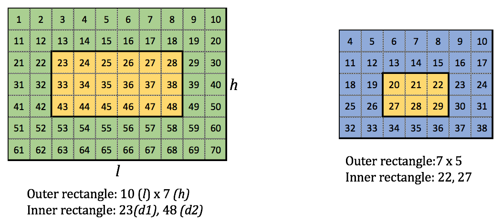

# RecXor

**IEEEXtreme 11.0** · Time limit: 500 ms · Memory limit: 256 MB

**CS Academy:** <https://csacademy.com/ieeextreme-practice/task/f8d68dbb0c844910797ce64354c66143/>

A rectangle of dimensions <Latex value="l \times h"/> <Latex value="(1 \leq l, h \leq 10^6)"/> is filled with numbers sequentially starting from number <Latex value="n"/> <Latex value="(1 \leq n \leq 10^9)"/> till the end of the rectangle. There is a second rectangle that fits inside the first rectangle and is defined by the end points of either of the diagonals, say <Latex value="d_{1}"/>  and <Latex value="d_{2}"/> <Latex value="(n \leq d1 \leq d2 < n + l*h)"/> which denote the numbers the diagonal starts from and ends at respectively. Your task is to find the `xor` of all the numbers that are not common to both of the rectangles. (Images below for better understanding.)



## Standard input

Input begins with a single number <Latex value="t"/> <Latex value="(1 \leq t \leq 100)"/>, which denotes the number of test cases.

Each test case begins with a line, which contains $5$ space-separated integers $l$, $h$, $n$, $d_{1}$  and $d_{2}$.

## Standard output

For each test case output a single number which is the `xor` of all the number that are not common to the rectangles.

## Constraints and notes

- $1 \leq t \leq 100$
- $1 \leq l, h \leq 10^{6}$
- $1 \leq n \leq 10^{9}$
- $d_{1} \le d_{2}$
- The sum of $l$ for all the tests in a file is $\leq 10^6$
- The sum of $h$ for all the tests in a file is $\leq 10^6$

## Examples

### Example 1

Input:
```
2
10 7 1 23 48
7 5 4 22 27
```

Output:
```
80
42
```

Explanation:

The test cases are for the images above. The `xor` of the uncommon numbers are 80 and 42 respectively.
