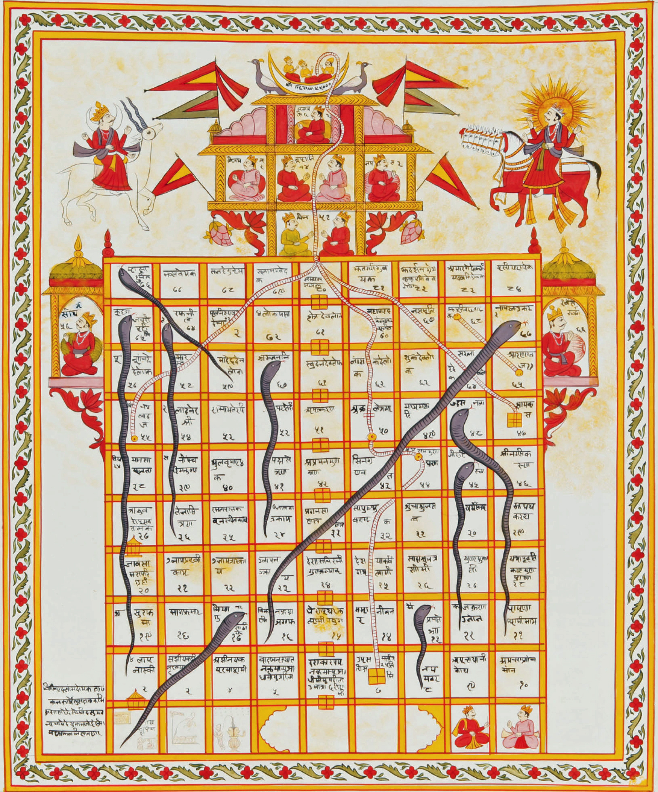

# Infinite snakes and ladders

**IEEEXtreme 12.0** · Time limit: 3900 ms · Memory limit: 256 MB

**CS Academy:** <https://csacademy.com/ieeextreme-practice/task/infinite-snakes-and-ladders/>

[Snakes and ladders](https://en.wikipedia.org/wiki/Snakes_and_Ladders) is a well known board game that goes back many centuries. Rules are simple, players start at the bottom left, roll the dice to move in a zig-zag path towards the top-left corner, use ladders to get higher, eaten by snakes to get back to their tail. Your task is to simulate the board game among players at a given board.



### Example

We have a $4 \times 4$ board (positions $1$ to $16$) and two players that start outside the board at position $0$ and win at position $17$.

```
17 16  15  14  13
    9  10  11  12 
    8   7   6   5 
0   1   2   3   4
```
Each cell can be identified through a plain XY axis coordinate system as follows:

```
(0,4)   (1,4) (2,4) (3,4) (4,4) 
        (1,3) (2,3) (3,3) (4,3) 
        (1,2) (2,2) (3,2) (4,2)
(0,1)   (1,1) (2,1) (3,1) (4,1)
```

Note that in this $4 \times 4$ board, from $(1,1)$ up to $(4,4)$ are positions on the board while $A \ (0,1)$ is the starting point and $B \ (0,4)$ is the winning position. Both $A$ and $B$ are one cell to the left of $(1,1)$ and $(1,4)$ respectively.

We have a single *snake* and a single *ladder*:

- *Snake* with the head at position $(4,1)$ and the tail at position $(2,1)$.
- *Ladder* which starts at $(4,2)$ and ends at $(2,3)$.

Players always start at $(0,1)$ and roll two $6$-sided dice, the sum is the number of position they move. The dice rolls are given in the input for our example: `1 4, 4 1, 3 1, 5 3, 5 6, 5 4, 1 4, 1 4, 1 3, 3 3`.

```
Player  Dice        Before       Why     After
1       1+4 = 5      0 at (0,1)  dice     5 at (4,2)
                     5 at (4,2)  ladder  10 at (2,3)
2       4+1 = 5      0 at (0,1)  dice     5 at (4,2)
                     5 at (4,2)  ladder  10 at (2,3)
1       3+1 = 4     10 at (2,3)  dice    14 at (3,4)
2       5+3 = 8     10 at (2,3)  dice    18. This player won because they reached position 17.
1       5+6 = 11    14 at (3,4)  dice    25. This player won because they reached position 17.
-       5+4         Just rolling the dice, all players have won
-       1+4         Just rolling the dice, all players have won
-       1+4         Just rolling the dice, all players have won
-       1+3         Just rolling the dice, all players have won
-       3+3         Just rolling the dice, all players have won
```

## Standard input

For the example above, input is given from standard input as follows:

```
4         // Board size, always an even number within [4, 10^6]
2         // P Number of players, integer within [2, 10]
1         // S Number of snakes, integer within [0, 10^5]
4 1 2 1   // S lines, for each snake head towards snake tail
1         // L Number of ladders, integer within [0, 10^5]
4 2 2 3   // L lines, for each ladder start towards ladder end
10        // K Number of roll dice pairs, integer in [1, 2 x 10^6]
1 4       // 1st roll of two 6-sided dice
4 1       // 2nd..
3 1
5 3
5 6
5 4
1 4
1 4
1 3
3 3       // K-th roll
```

## Standard output

For each player, counting from player #1 towards player #P, print the player number followed by the word `winner` (if the player has won) or flowed by the coordinates $x,y$ of his final position. For our example, the output would be the following:

```
1 winner
2 winner
```
In case we had a different input and player $1$ had reached cell $6$ and player $2$ had never rolled the dice (an acceptable situation), the output would be:

```
1 3 2
2 0 1
```

## Constraints and notes

- When a player has already won, skip their turn and use their dice rolls for the players still in the game. If every player has already won, the remaining dice rolls are unused.
- *Ladders* always go up, *snakes* always go down. Never use a *ladder* to go down or a *snake* to go up.
- A position can not have both a *snake* head and a start from a *ladder*.
- If after following a *ladder* or a *snake*, a player ends up at a position with a *ladder* start or a *snake* head, they must follow it as well. However, there will be no infinite loops of *ladders* and *snakes*.

## Examples

### Example 1

Input:
```
4
2
1
4 1 2 1
1
4 2 2 3
10
1 4
4 1
3 1
5 3
5 6
5 4
1 4
1 4
1 3
3 3
```

Output:
```
1 winner
2 winner
```
