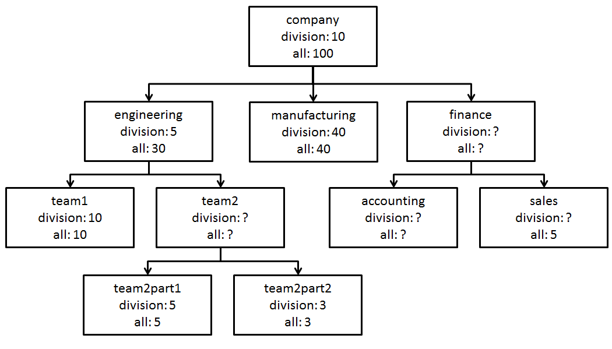

# Organizational Chart

**IEEEXtreme 12.0** · Time limit: 4000 ms · Memory limit: 256 MB

**CS Academy:** <https://csacademy.com/ieeextreme-practice/task/organizational-chart/>

The new Chief Executive Officer (CEO) at Big Tech wants to gather information on all of the divisions in the company.  The CEO gathered all top management and asked them to report on the number of employees in each of the top level divisions.  These managers in turn asked all of their subordinates for the number of employees in the child divisions of these top level divisions, and so on.

You have been given the organizational chart and the reported numbers, as well as a list of queries for the sizes of different divisions.  However, some of these numbers are missing.  You task is to provide lower and upper bounds for each of the queries.

## Standard input

The input begins with two integers $N$ and $Q$.

Next come $N$ lines each describing all divisions in the following format:

```
[division_name] [parent_division] [size1] [size2]
where 
	[division_name] is a child of [parent_division]
	[size1] is the number of employees in [division_name] but not any child division below it in the corporate hierarchy. 
	[size2] is the number of employees in [division_name] including all divisions below it in the corporate hierarchy.
If there is no parent, the [parent_division] will be equal to “NONE”.
If a size is missing, the size value will be set to 0.
```
Next come $Q$ lines each describing each query in the form:

```
[division_name] [type]
where 
	[division_name] is a division name that exists in the corporate hierarchy, and
	[type] is either 1 or 2
```

## Output

For each query, your program should output a single line with two integers separated by a space.

For type $1$ queries, you are to output lower and upper bounds on the number of employees in that division, *not including* divisions below it in the corporate hierarchy.

For type $2$ queries, you are to output lower and upper bounds on the number of employees in that division *including* divisions below it in the corporate hierarchy.

## Constraints and notes

- $1 \leq N,Q \leq 2 * 10^5$
- The maximum number of employees in the organization is $6 * 10^9$.  (There is a reason the company is called Big Tech).
- Each division name is unique and is made up only of lowercase letters, numbers, and the underscore.
- The corporate hierarchy is a <Definition term="rooted tree">.
- Every division must have at least one employee who is not an employee of a child division.
- All employees of a child division are also employees of the parent division, but not vice versa.

## Examples

### Example 1

Input:
```
10 3
company NONE 10 100
engineering company 5 30
team1 engineering 10 10
team2 engineering 0 0
team2part1 team2 5 5
team2part2 team2 3 3
manufacturing company 40 40
finance company 0 0
accounting finance 0 0
sales finance 0 5
company 1
team2 2
accounting 1
```

Output:
```
10 10
15 15
1 14
```

Explanation:



The sample input corresponds to the organizational chart above.

The first query is for the size of *company*, not including its subdivisions, which is given as 10 in the input. Therefore, both the lower bound and upper bound are 10.

The second query is for the size of *team2* and its subdivisions. There are a total of 30 employees in the *engineering* and its portion of the hierarchy. Five are in the *engineering* and 10 are in *team1*. Therefore, *team2* and its subdivisions must have exactly 15 people.

For the last query, we know that there must be at least one person in the *accounting* division, not including its subdivisions.  For the upper bound, we know that there are 20 people in the *finance* portion of the hierarchy.  Of these, at least 6 must be in *finance and sales*, so the upper bound for *accounting* is 14.
