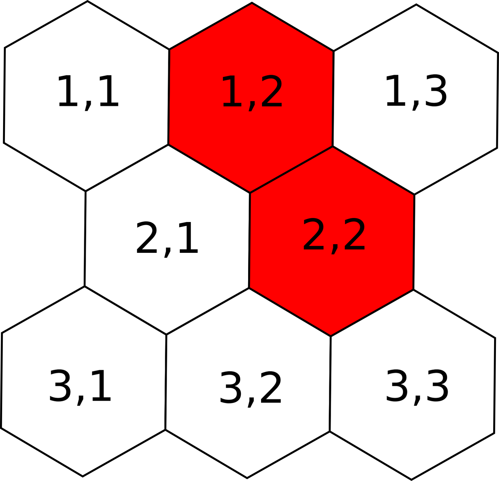
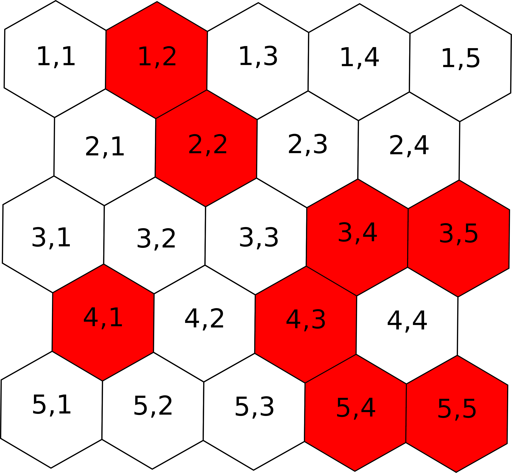

# Protecting the Hive

**IEEEXtreme 13.0** · Time limit: 500 ms · Memory limit: 256 MB

**CS Academy:** <https://csacademy.com/ieeextreme-practice/task/protecting-the-hive/>

The Alfa rabbit has a bee friend that provides him with honey, called Maya. Maya is the queen of the bees and she belongs to the hive. The hive is the place where the worker bees produce and conserve honey.

The hive is made of cells, each cell has the form of a hexagon where each side of this hexagon measures $1$ cm. The hive has $N$ rows, where every odd row has $M$ cells and every even row has $M-1$ cells. Each cell can be active or inactive. An active cell is where the bees can produce honey, while an inactive cell it has some problem and the bees cannot produce honey there.

The hive is composed of many sections, where a section is made of a set of connected cells (two cells are connected if they are adjacent to each other through one of their $6$ sides). Maya is able to:

1. Create a perimeter with a special substance for each section in order to protect it from other insects.
1. Activate an inactive cell.

From time to time, Maya wants to know, given a specific cell, what is the perimeter of the section it belongs to. Can you help the queen?

## Standard input

The input will consist of the numbers $N$ and $M$, where $N$ is the number of rows and $M$ is the number of columns for the odd rows, followed by $N$ rows of numbers.

Row $1$ consists of $M$ numbers (either $0$ or $1$, where $0$ represents an inactive cell and $1$ represents an active cell), row $2$ consists $M-1$ numbers and so on.

On the next line we have the number $Q$ that represents the number of queries, followed by $Q$ query lines, where each query is of the form "`a` $\text{row}$ $\text{column}$" or "`k` $\text{row}$ $\text{column}$". If the first letter of the query is `a` it means that the queen wants to activate the cell ($\text{row}$, $\text{column}$), otherwise, if the first letter of the query is `k` the queen wants to know the perimeter of the section that the cell ($\text{row}$, $\text{column}$) belongs to.

## Standard output

The output consists of a number of lines equal to the number of `k` queries, where every line represents the answer to each query where the queen wants to know the perimeter of the section.

## Constraints and notes

- $2 \le N \le 100$
- $2 \le M \le 100$
- $1 \leq Q \le 10^5$
- The queries will consist of only valid cells.

## Examples

### Example 1

Input:
```
3 3
0 1 0
0 1
0 0 0
5
a 1 3
k 2 2
k 2 1
a 3 1
k 3 1
```

Output:
```
12
0
6
```

Explanation:



### Example 2

Input:
```
5 5
0 1 0 0 0
0 1 0 0
0 0 0 1 1
1 0 1 0
0 0 0 1 1
8
a 2 1
k 2 1
k 1 2
k 3 4
k 4 1
k 5 5
a 3 3
k 3 3
```

Output:
```
12
12
22
6
22
34
```

Explanation:


