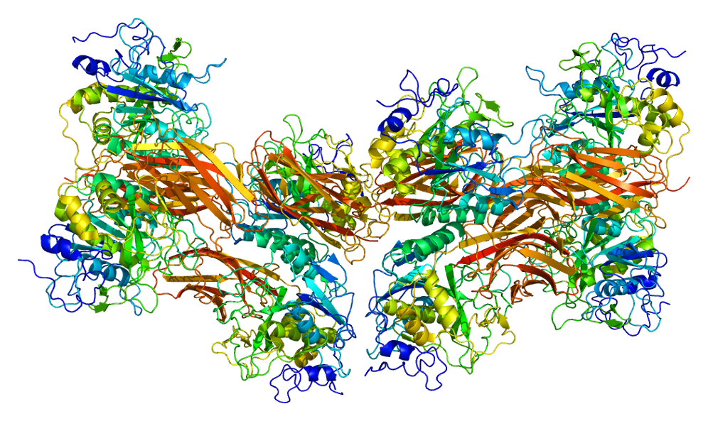

# Furin Back

**IEEEXtreme 14.0** · Time limit: 3000 ms · Memory limit: 256 MB

**CS Academy:** <https://csacademy.com/ieeextreme-practice/task/furin-back/>

Write a program that does what the following program does:

<CodeSnippet numLines={48} value="                                     >,<>>,>,<[->-

                                  >+<><<]+->>[-<<+>>]

                                <+-><><<<[-+->-<+-<+>]<

                               [->+<]><>>>>>><>++->>+->>

                              >>>+[>><>>>[-]<[-<>-+]<<>[-

                             +-]-++-+-<         [-]<><<>[+

                            ---+]<><<             <<+-<<<<>

                           -+<><<<>                 <+-<<[->

                          >>>>>>+                     >>>>>-+

                         >+<<<><            <          <><<<<<

                        <<<<]>[           ->>           >>><><>

                       ><>>+>>          >>>>+            <<<<<><

                      <<<<+-<           <<<]>             [->>>>>

                                        >><>+

                                        >>>>-

                                        +><>>

                                        +<<<<

                                        <<+-<

         <<<><<<<        -+><]     >>-++-+>+-+[<-]      <[->>

      <>++-<<<]>>>>      [-<<<     +--+<<<<+>><>>>      >>>]>

     [-<<-+<<<<<+<>>     +->>>     >>>]>[-<<<<><<<      ><<+>

    >>>>>>]>>>>>><>>+    [-<<<     <+--+<><+-<<<<<      <[->>

   +>>+<<<<]+->[->>+>>   +-+<<     <<]>[-<<+>>]>[-      <<+>>

  ]+[[<>-]-++>[<-]<+-[   +--><     >><>-<<<]>>-+->      >>+>[

 <-]<+-[-       >+>[-    <-]<[          >>[-<           <-+->

 ]-<<[->         ><-     >+->-          +-<<<           <]]<]

 >>-<<<           <      <+>[>          <<-]<           [>+->

[-+<<-                   >]<<[          <]]>-           +-]>>

>>><>>                   >><>+          ]-<<<           >+-<<

<>+>-                    ++[<-          ]<[-+           >>+[<

<<>->                    -+]<<          [>>>+           [<-+<

<->>]                    <<<[<          ]]]>-           ]>>>>

[-]<<                    <<<<<          -+<><           <<<<<

<[-]>                    >+>+[          <-]<[           ->>+<

><<<]                    >+>[<          -]<[>           >[<<-

>]<<[                    <]]>-          [+>>>           >>>><

++-++                    +++++          ++<<<           <<<+>

+-[<<>                   -]<[>          >[<<-           >]<<[

<]]>-[                   ++>[<          -]<[-           >>-<<

 <]>>->           >      +>>+>          -[<-]           <[<<[

 ->>>+<<         ><<     ]+->>          >>>+>           +[<><

 -]<><[->       >+<<<    ]<<-<          ]<<<<           +>[<-

  ]<[>>[<<->]<<[<]]>-]   >>+++          +++++[   ->     +++++

   +<]>[-<<<<+>>>>]>>>   >>+><          >-+[<-]<[>>     [<<->

    ]<<[<]]>-[++>[<-]    <[->>          -<<<]>>-<<<     <<<<<

     +>+[<-]<[->>+<<     <]>>>          >>>>>+>[<-      ]<[>>

      [<<->]<<[<]]>      -]<<[           -]<<<<<+>      [<-]<

         [>>[<<->        ]<<[<            ]]>-]<<       [.<]!    ">



Hint: I gave no one real evidence. Furin is not dielectric; and not a great random acoustic magnet; oxidized filovirus; towards human enzyme; this is to lure enigma.

## Standard input

The first line contains an integer $T$, the number of test cases.

The next $T$ lines each contain a string of three printable ASCII characters representing one test case.

## Standard output

For each test case, print the output of the given program on a single line.

## Constraints and notes

- $1 \leq T \leq 10$
- A printable ASCII character has an unsigned $8$-bit integer value between $33$ and $126$.

## Examples

### Example 1

Input:
```
4
xxx
XXX
***
<=>
```

Output:
```
12
90
44
4
```

### Example 2

Input:
```
2
0>?
dkx
```

Output:
```
264
884
```
