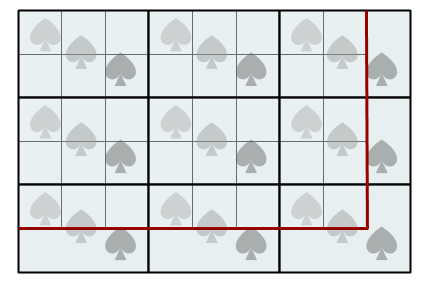
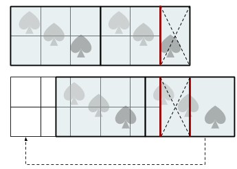

# Mosaic Decoration II

**IEEEXtreme 14.0** · Time limit: 1000 ms · Memory limit: 256 MB

**CS Academy:** <https://csacademy.com/ieeextreme-practice/task/mosaic2/>

Zapray lives in a big mansion that has many bathrooms. He wants to decorate one bathroom wall using mosaic tiles. The bathroom wall has a width of $W$ inches and a height of $H$ inches. All mosaic tiles have a width of $A$ inches and a height of $B$ inches. The mosaic tiles are placed on the wall with their sides aligned horizontally and vertically. The right/bottom side of each tile is aligned with the left/top side of another tile, except for the tiles on the boundaries of the wall. The mosaic tiles have directional decorative patterns on them, and they cannot be rotated or flipped. Since $A$ may not divide $W$, and $B$ may not divide $H$, the tiles on the boundaries of the walls may have to be cut to fit. One mosaic tile can be cut into multiple pieces to be placed along different boundaries of the wall.

Mosaic tiles are sold in piles. Zapray can purchase one pile of $10$ mosaic tiles for $M$ dollars. He also has to pay the worker $C$ dollars per inch for making cuts on the mosaic tiles. What is the minimum total amount of money that Zapray needs to cover the entire bathroom wall with mosaic tiles?

## Standard input

The input contains six integers on a single line: $W, H, A, B, M, C$.

## Standard output

Output a single integer, the minimum amount of money in dollar that Zapray needs.

## Constraints and notes

- $1 \leq W, H, M, C \leq 10^6$
- $1 \leq A \leq W, 1 \leq B \leq H$

## Examples

### Example 1

Input:
```
8 5 3 2 100 3
```

Output:
```
139
```

Explanation:



Zapray needs $9$ mosaic tiles and has to purchase one pile of tiles for $100$ dollars. There are multiple ways to arrange the tiles. The figure shows one optimal way with a minimum total cost. Zapray needs to have the worker cut $5$ of the tiles on the right and bottom boundaries. The total length of the cut is $13$ inches and the cost of the cut is $13 \times 3 = 39$ dollars. The cut lines are illustrated in red.

### Example 2

Input:
```
5 2 3 2 100 3
```

Output:
```
106
```

Explanation:



Zapray needs $2$ mosaic tiles and has to purchase one pile of tiles. There are multiple ways to arrange the tiles. The figure shows two ways. In the first way, Zapray places one full tile at the leftmost position. He makes one cut on the second tile and discards one-third of it. In the second way, Zapray places one full tile in the middle of the wall at 1.5 inches to the left boundary. He then makes cuts the second tile into three parts with a width of $0.5, 1, 1.5$ inches. He discards the middle part, and places the right part ($1.5$ inches) to the leftmost of the wall. The cutting cost of the second way is higher than the first way. Thus the second way is not optimal.

### Example 3

Input:
```
98765 43210 1 1 777 1
```

Output:
```
331595290005
```

Explanation:

No tile cutting is needed.
