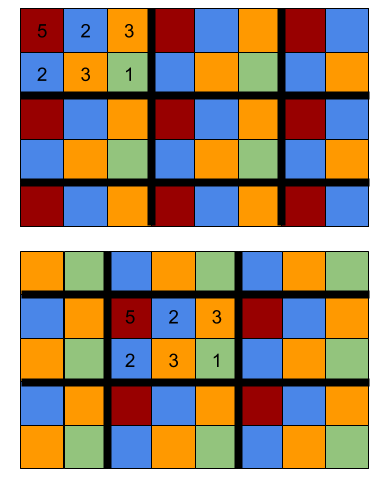

# Mosaic Decoration III

**IEEEXtreme 14.0** · Time limit: 1000 ms · Memory limit: 256 MB

**CS Academy:** <https://csacademy.com/ieeextreme-practice/task/mosaic3/>

Zapray lives in a big mansion that has many bathrooms. He wants to decorate one bathroom wall using mosaic tiles. The bathroom wall can be viewed as a grid of $N$ rows and $M$ columns of cells. Each mosaic tile covers exactly one cell on the wall. Zapray has a /base pattern/ of mosaic tiles that has $R$ rows and $C$ columns. Each tile in the base pattern has some color labeled by a positive integer. Zapray will first choose one location on the wall to place the base pattern, and then he will repeat the base pattern horizontally and vertically to cover the entire wall.

In the example below, the wall has $N=5, M=8$, and the base pattern has $R=2, C=3$. The base pattern has tiles of four different colors labeled $1, 2, 3, 5$. If Zapray chooses to place the base pattern at the top-left of the wall, the pattern will fill the wall as shown in the first image. If Zapray moves the base pattern to the right by two columns, and to the bottom by one row, the pattern will fill the wall as shown in the second image.



For any color labeled $c$, Zapray can purchase one mosaic tile of that color for $c$ dollars. If Zapray chooses to place the base pattern at the best location and then fill the wall, what is the minimum total cost he has to pay to have the entire wall decorated by mosaic tiles?

## Standard input

The input has four integers $N, M, R, C$ on the first line.

The next $R$ lines each have $C$ positive integers, giving the mosaic tile colors in the base pattern.

## Standard output

Output a single integer, the minimum total cost in dollars that Zapray needs to pay.

## Constraints and notes

- $1 \leq N, M \leq 10^6$
- $1 \leq R \leq \min(50, N), 1 \leq C \leq \min(50,M)$
- All color labels are between $1$ and $10^6$.

## Examples

### Example 1

Input:
```
5 8 2 3
5 2 3
2 3 1
```

Output:
```
98
```

Explanation:

This test case is illustrated in the figure above. The second base pattern location gives the optimal solution that needs $4$ tiles of color $5$ (shown in red), $12$ tiles of color $2$ (shown in blue), $15$ tiles of color $3$ (shown in orange), and $9$ tiles of color $1$ (shown in green). The total cost is $4 \times 5 + 12 \times 2 + 15 \times 3 + 9 \times 1 = 98$ dollars.
