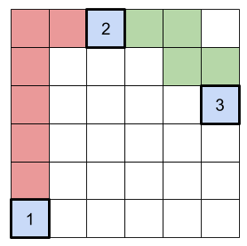

# Parkour

**IEEEXtreme 14.0** · Time limit: 2500 ms · Memory limit: 256 MB

**CS Academy:** <https://csacademy.com/ieeextreme-practice/task/parkour/>

Catom is practicing parkour in the scaffolding of the new building in the city. The floor of the scaffolding is a grid. The cell in the $x$-th position to the right and the $y$-th position to the top has coordinates $(x, y)$. Each cell should contain a floor tile. But as the building is not finished, there are only $N$ cells numbered from $1$ to $N$ that currently contains a floor tile at positions $(x_1, y_1),(x_2, y_2), ..., (x_N, y_N)$. These tiles are glued to the floor and called /stable tiles/.

In the entrance of the building there are $k$ floor tiles waiting to be put on the floor. These tiles are called /movable tiles/. The movable tiles are very heavy and can only be moved using a crane. Catom has a remote control for the crane but it is very complicated to operate. Catom can thus only use the crane to move a movable tile when he is on a stable tile, because he needs the balance. When a movable floor tile is placed on a cell, it does not become glued to it, so it may be moved again. In other words, Catom can replace the movable floor tiles wherever he likes when standing on a stable tile.

Parkour is the art of getting from one point to another in a complex environment. Catom starts at stable tile $s$ and wishes to reach stable tile $t$ under the following constraints:

- Catom can only step on floor tiles on his way.
- Catom can move from one floor tile to another only if they share a common edge.
- Catom can only move the movable tiles, and only when he is on a stable tile.

Help Catom complete his parkour training by determining for some $(s, t, k)$ values whether or not Catom can go from stable tile $s$ to stable tile $t$. You need to answer $Q$ such queries $(s_1, t_1, k_1), (s_2, t_2, k_2), ..., (s_Q, t_Q, k_Q)$.

## Standard input

To reduce the size of the input file, not all input data will be given explicitly. Instead, a set of parameters will be provided to generate the data.

The input has four integers $N, Q, S_Q, M_k$ on the first line. $S_Q$ is the number of queries that are explicitly given. $M_k$ is a modulus used for generating the data.

The following $N$ lines each have two integers as the position of one stable tile. The $i$-th line has $x_i$ and $y_i$.

The next line has nine integer parameters $A_s, B_s, C_s, A_t, B_t, C_t, A_k, B_k, C_k$. These are followed by $S_Q$ lines that each contain three integers as one query. The $i$-th line has $s_i, t_i, k_i$. The remaining queries with $S_Q < i \leq Q$ are generated using the following rules:

- $s_i = (A_s \cdot s_{i-1} + B_s \cdot s_{i-2} + C_s) ~mod ~ N + 1$
- $t_i = (A_t \cdot t_{i-1} + B_t \cdot t_{i-2} + C_t) ~mod ~ N + 1$
- $k_i = (A_k \cdot k_{i-1} + B_k \cdot k_{i-2} + C_k) ~mod ~ M_k$

## Standard output

Let the answer to the $i$-th query be $R_i$. If Catom can reach stable tile $t$ from stable tile $s$ then $R_i=1$, and otherwise $R_i=0$. Output a single integer $\sum_{1\leq i \leq Q} R_i \cdot 2^i ~mod~ (10^9 + 7)$, which is the combined answers to all queries.

## Constraints and notes

- $1 \leq N \leq 10^5$
- $1 \leq Q \leq 10^7$
- $2 \leq S_Q \leq Q$
- $1 \leq M_k \leq 10^9$
- $0 \leq x_i, y_i < 10^9$ for $1 \leq i \leq N$, all $(x_i, y_i)$ are unique.
- $1 \leq s_i, t_i \leq N, 0 \leq k_i < M_k$ for $1 \leq i \leq Q$
- $0 \leq A_s, B_s, C_s, A_t, B_t, C_t, A_k, B_k, C_k \leq 10^9$

- For $25\%$ of the test data, $N, Q \leq 500$.
- For another $25\%$ of the test data, $N, Q \leq 10^5$ and $1 \leq M_k \leq 4$.
- For another $25\%$ of the test data, $N, Q \leq 10^5$.

## Examples

### Example 1

Input:
```
3 2 2 100
0 0
2 5
5 3
0 0 0 0 0 0 0 0 0
1 3 6
2 1 5
```

Output:
```
2
```

Explanation:

All stable tile positions and queries are explicitly given. The three stable tiles are illustrated below in blue.



For the query $s_1=1, t_1=3, k_1=6$ the answer should be $R_1=1$, because Catom can put the $6$ movable floor tiles in a path from stable tile $1$ to stable tile $2$ (shown in red), go to stable tile $2$, then move $4$ of the movable tiles to connect stable tile $2$ and stable tile $3$ (shown in green) and finally get to stable tile $3$.

For the query $s_2=2, t_2=1, k_2=5$ the answer should be $R_2=0$ since Catom can not reach stable tile $1$ with fewer than $6$ movable tiles.

The answer is therefore $(R_1 \cdot 2^1 + R_2 \cdot 2^2)~mod~ (10^9 + 7) = (1 \cdot 2 + 0 \cdot4) ~mod~ (10^9 + 7) = 2$.

### Example 2

Input:
```
3 7 2 9
0 0
2 5
5 3
7 8 10 3 2 1 5 4 59
1 3 6
2 1 5
```

Output:
```
242
```

Explanation:

Just $2$ queries are explicitly given. The three stable tiles are the same as in test case #1.

The $7$ queries are

```
1 3 6
2 1 5
3 2 0
3 1 7
2 3 4
1 1 8
1 2 7
```
$R_1, R_4, R_5, R_6, R_7 = 1$

$R_2, R_3 = 0$

The answer is therefore $(R_1 \cdot 2^1 + R_2 \cdot 2^2 + \cdots + R_7 \cdot 2^7)~mod~ (10^9 + 7)$ $= (1 \cdot 2 + 0 \cdot4 +  0 \cdot8 + 1 \cdot 16 + 1 \cdot 32 + 1 \cdot 64+ 1 \cdot 128 ) ~mod~ (10^9 + 7)$

$= 242$.
