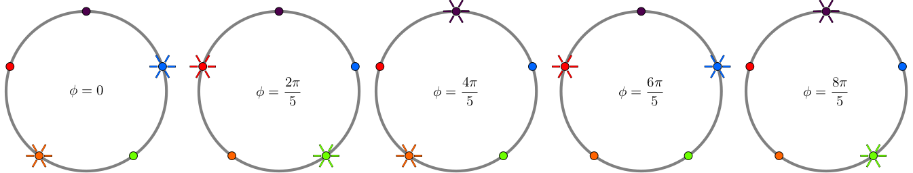
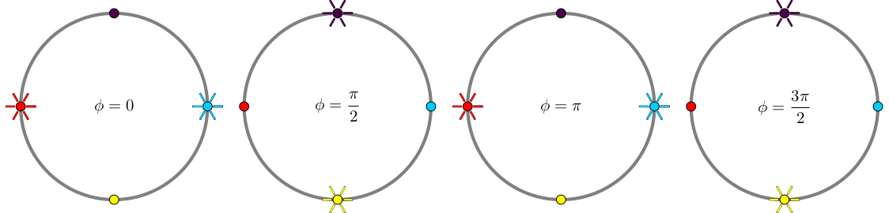
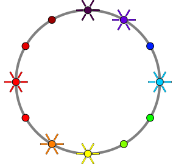

# Rotational Lights

**IEEEXtreme 14.0** · Time limit: 1000 ms · Memory limit: 256 MB

**CS Academy:** <https://csacademy.com/ieeextreme-practice/task/rotational-lights/>

Your little brother Jerry is four years old.  He's quite fun to be around, unless you have work to do.  When this happens, you need something to keep him occupied.

Luckily for you, on his birthday, Jerry got a new game that he can't resist playing. It's called "all the colors of the rainbow" and consists of a circle with $T$ LED lights, evenly distributed on its circumference. Each of the lights has a different color (hence the name) and comes with a switch, so you can either turn it on or off. Four-year old boys get easily excited with these things.

You really don't know the rules of the game but, every time Jerry wants to play, he asks you to provide an initial configuration: turn some of the lights on and leave the rest off. After you do this, Jerry plays the game on his own: he keeps switching lights on and off until he's satisfied with the result and declares victory.

Although you really don't understand your brother's game, you've noticed three important things:

- Some initial configurations are easier than others for Jerry to solve. So, once in a while you pick a hard configuration that keeps Jerry busy for a longer time.
- If a configuration is hard, so are all of its rotations. A rotation of a configuration is what you get by rotating the lights that are turned on by some angle that is a multiple of $2\pi/T$.
- Jerry remembers the configurations he's already played, so if you find a hard one, you cannot directly reuse it. He somehow remembers the combinations of the colors. However, you can still trick your brother by using a rotation, as long as the result is a configuration that he hasn't previously seen.

You just found a new hard configuration that kept Jerry busy for one hour straight! Assuming that Jerry had not played any of this configuration's rotations before, how many such rotations can you use to keep Jerry busy?

## Standard input

The first line will contain two space-separated positive integer numbers, $N$ and $T$: the number of lights that are turned on in the initial configuration and the total number of lights.

The second line will contain $N$ space-separated integer numbers, the positions of the lights that are turned on.  These numbers will be in the range $[0, T)$ and will be provided in strictly ascending order.  (In our examples, we make the arbitrary assumptions that position $0$ is in the north and that positions increase clockwise.)

## Standard output

Your program must print a single line containing a single integer number: how many different rotations of the initial configuration exist.

## Constraints

- $1 \le N \le T$.
- For $10\%$ of the test data, $T \le 10^3$.
- For $40\%$ of the test data, $T \le 10^6$.
- For $70\%$ of the test data, $N \le 10^6$ and $T \le 10^9$.
- For $100\%$ of the test data, $N \le 10^6$ and $T \le 10^{18}$.

#### Figure of Sample Test 0



#### Figure of Sample Test 1



#### Figure of Sample Test 2



## Examples

### Example 1

Input:
```
2 5
1 3
```

Output:
```
4
```

Explanation:

In this example, $T=5$ and in the initial configuration only the blue and orange lights are turned on. There are four more rotations, for $\displaystyle \phi \in \left\{\frac{2\pi}{5}, \frac{4\pi}{5}, \frac{6\pi}{5}, \frac{8\pi}{5}\right\}$, all of them different.

### Example 2

Input:
```
2 4
1 3
```

Output:
```
1
```

Explanation:

In this example, $T=4$ and in the initial configuration only the red and cyan lights are turned on.  There are three more rotations, as shown below.  However, only the first rotation (for $\phi=\frac{\pi}{2}$) is different.  The second rotation (for $\phi=\pi$) is the same as the initial configuration, because the same lights are turned on.  Also, the third rotation (for $\phi=\frac{3\pi}{2}$) is the same as the first rotation.

### Example 3

Input:
```
6 12
0 1 3 6 7 9
```

Output:
```
5
```

Explanation:

The initial configuration is shown in the image.  There are five different rotations, for $\displaystyle \phi \in \left\{\frac{\pi}{6}, \frac{\pi}{3}, \frac{\pi}{2}, \frac{2\pi}{3}, \frac{5\pi}{6}\right\}$.
