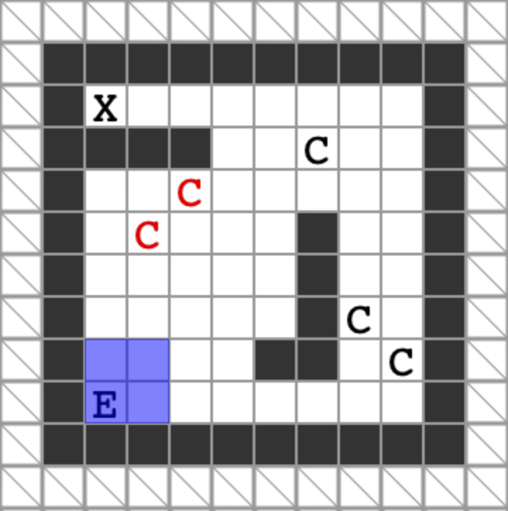

# The Last of Us

**IEEEXtreme 14.0** · Time limit: 1000 ms · Memory limit: 256 MB

**CS Academy:** <https://csacademy.com/ieeextreme-practice/task/the-last-of-us/>

In this challenge, we will relive a nerve-racking journey of a popular game character named Ellie -- in an Xtreme way!

On the journey to her revenge, Ellie goes through a dangerous forest full of a type of monsters called /clickers/. A clicker was once a human, but contracted the dangerous Cordyceps fungus that turned people into monsters. A clicker is blind and has no sight. But it has an adaptive echolocation that can be used identify its surroundings. A clicker is extremely sensitive to sound.

Ellie's journey will go through $T$ areas. Each area is a 2D grid of cells. Each cell is either walkable (`.` or `E`) or blocked (`#`). The cell `E` is the exit of the area. There are clickers wandering in the area. Ellie is not carrying any ammo with her, and must bypass all the clickers and reach the exit of the area without engaging in a combat. Ellie is carrying $B$ bricks with her, which can be thrown to distract the clickers.

- The /distance/ between two cells $(x_1, y_1), (x_2, y_2)$ is $max(|x_1 - x_2|, |y_1 - y_2|)$.
- The /absolute offset/ between two cells $(x_1, y_1), (x_2, y_2)$ is $|x_1 - x_2| + |y_1 - y_2|$.
- Two cells $(x_1, y_1), (x_2, y_2)$ are /adjacent/ if their distance is $1$.
- The /surroundings/ of a cell $(x, y)$ consists of all the cells that have a distance no larger than $7$ from $(x, y)$.
- The /vicinity/ of a clicker consists of all the cells that have a distance no larger than $2$ from the clicker's location. A clicker may hear any /sound/ in its vicinity and become /alerted/.
- A cell is /empty/ if it is walkable, does not contain a clicker, and not the exit of the map.
- The /shortest path/ of a clicker between a pair of two walkable cells $s, t$ are the shortest sequence of *walkable* cells (NOT empty cells) that connect $s$ and $t$, excluding the exit `E`.

The game takes turns. Each turn starts with Ellie's move, followed by the move of each clicker in the area one by one.

On Ellie's turn, she may choose to:

- Walk to an adjacent cell $x$. $x$ must be an empty cell or the exit. Ellie succeeds if the cell is the exit of the area. Ellie makes a sound in $x$ by walking into it.
- Throw a brick she carries to an empty cell $x$ in her surroundings. The brick will crack and make a sound in $x$. A thrown brick cannot be used again.

On a clicker's turn, it follows these rules:

- If Ellie is standing in a cell that is adjacent to the clicker, the clicker will sense Ellie, grab and kill her immediately. Note that this takes the highest priority regardless of whether the clicker heard a sound or not.
- If a clicker is non-alerted, it will do nothing and stand still.
- If a clicker is alerted by a sound, it will walk to an adjacent cell on any shortest path to the cell $x$ that produced the sound. If there are multiple cells on a shortest path, it will take the cell that has the smallest absolute offset to $x$. If there are still multiple such cells, the clicker will choose the cells in clockwise order starting from the cell on the top.
- If there is no path to cell $x$ or the clicker is already in cell $x$, the clicker stands still. If a clicker heard multiple sounds, it will always trace the last sound.

Your goal is to write a program that helps Ellie navigate and exit the $T$ areas of the game. We have provided a web game with an interface as shown below that allows you to play the $T$ areas manually. This helps you better understand the game and develop a strategy. The $T$ areas in the web game are exactly the same as the $T$ areas on which your solution will be tested on the judging platform. An area can be identified by its area name given in the input.

[Download the web game](https://publicmedia1.csacademy.com/public/1603207867-3697724467.zip)



## Standard input

Each test file contains exactly one of the $T$ areas. The input starts with one line of a single string, the area name. The second line of the input has a three integers $R$, $C$, and $B$. $R$ and $C$ indicate that the area size is $R$ rows by $C$ columns. $B$ is the number of bricks Ellie is carrying.

The next $R$ lines describe the area. Each line has a string of $C$ characters. A walkable cell is `.`, a blocked cell is `#`, Ellie's location is `E`, the exit is `X`, and a clicker is `C`.

## Standard output

Your solution should output a single integer $K$ on the first line, the total number of actions Ellie needs to exit the area.

On each of the next $K$ lines output one action:

- If Ellie chooses to walk to an adjacent empty cell, your program should print `w dx dy`, where $(dx, dy)$ are the relative coordinates of an adjacent cell or Ellie's current cell. `dx` is $1(-1)$ if Ellie walks to the right (left), and `dy` is $1(-1)$ if Ellie walks to the top (bottom). It must satisfy that $max(|dx|, |dy|) \leq 1$. Ellie may choose to stand still by `w 0 0`.
- If Ellie chooses to throw a brick, your program should print `b dx dy`, meaning that Ellie will throw a brick at the empty cell with relative coordinates $(dx, dy)$ from her current location. It must satisfy $max(|dx|, |dy|) \leq 7$.

Your solution must take no more than $10^5$ actions, and satisfy $K \leq 10^5$.

## Constraints and notes

- $10 \leq R, C \leq 500$
- $0 \leq B \leq 140$
- There is exactly one exit in each area. All walkable cells are reachable from the exit. It is guaranteed that there exists a way to reach the exit within $10^5$ actions.
- The clickers in the web game behave exactly the same as they do on the judging platform. Therefore if a sequence of actions works for an area in the web game, it will also work for that area on the judging platform.
- Any invalid action will receive /Wrong Answer/. An invalid action can be walking to a blocked cell, throwing a brick at a non-empty cell, throwing a brick after Ellie's has used all the bricks, etc.
- The last action should be Ellie walking to the exit. Any action after Ellie reaches the exit will be considered invalid and receive /Wrong Answer/.
- Ellie succeeds immediately when she enters the exit, even if a clicker is adjacent to the exit.
- There can be at most one clicker in a walkable cell. An alerted clicker may stand still when all the adjacent cells on a shortest path are occupied by other clickers. A clicker cannot step onto the exit, which is considered not walkable for the clicker when it determines shortest paths.
- On the clickers' turn, clickers move one after another. The topmost and then leftmost clicker moves first.
- A clicker's movement does not produce a sound and does not alert other clickers.

## Examples

### Example 1

Input:
```
area-0-sample
10 10 2
##########
#X.......#
####..C..#
#...C....#
#.....#..#
#C....#..#
#.....#C.#
#....##.C#
#E.......#
##########
```

Output:
```
14
b 1 5
w 1 0
w 1 0
w 1 1
w 1 1
b 3 5
w 0 1
w 0 1
w 0 1
w 0 1
w -1 1
w -1 0
w -1 0
w -1 0
```

Explanation:

You may interactively enter the example sequence of actions in the web game and view how Ellie can exit the area by these actions. Choose `sample` as the area in the web game. Ellie distracts the clickers by luring them to the boundaries of the area, opening a path in the middle leading to the exit.
