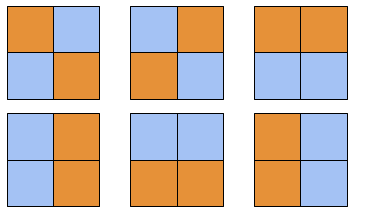
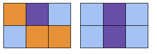
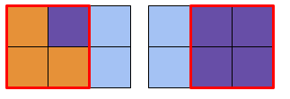

# Coloring Tiles

**IEEEXtreme 15.0** · Time limit: 6000 ms · Memory limit: 256 MB

**CS Academy:** <https://csacademy.com/ieeextreme-practice/task/coloring-tiles/>

There is a wall of $N$ rows and $M$ columns of tiles. Some tiles on the wall are /colorable/, while the others are /non-colorable/. You are to color all the colorable tiles using $C$ types of color pigments. Each type of color pigment has a unique color. Every colorable cell needs to be in one of these $C$ colors. Additionally, there should be no three colorable cells within any $2 \times 2$ square that have a same color. In how many ways (modulo $1\,000\,000\,007$) can you color the entire wall?

## Standard input

The input has a single integer $T$ on the first line, the number of test cases.

Each test case has three integers $N, M, C$ on the first line. The next $N$ lines each has $M$ characters describing one row of the wall. Each character is either a dot `.`, denoting a colorable tile, or a hash `#`, denoting a non-colorable tile.

## Standard output

For each test case, output the number of ways to color the wall modulo $1\,000\,000\,007 (10^9 + 7)$ on a single line.

## Constraints and notes

- $1 \leq T \leq 10$
- $N, M \geq 2$
- $N \times M \leq 75$
- $2 \leq C \leq 4$
- There is at least one colorable tile on the wall.
- For $50\%$ of the test files, $N = 2$.

## Examples

### Example 1

Input:
```
3
2 2 2
..
..
2 3 3
...
...
2 6 4
..#..#
...#..
```

Output:
```
6
342
177840
```

Explanation:

- Case $1$: The illustration shows the $6$ different ways of coloring a $2 \times 2$ wall using $C=2$ colors.



- Case $2$: There are $342$ different ways, which are too many to enumerate here. Here are two valid ways to color the $2\times3$ wall with $C=3$ colors:



Here are two invalid ways. They are invalid because the highlighted red $2\times2$ square contains three cells of a same color.


