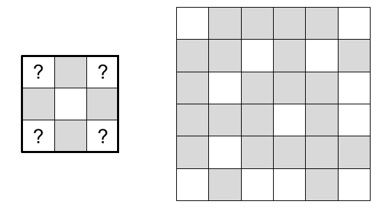
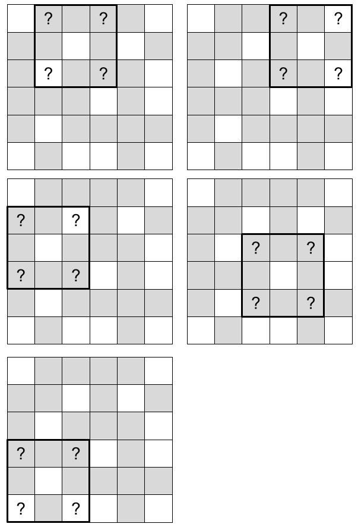

# Image Convolution

**IEEEXtreme 15.0** · Time limit: 8000 ms · Memory limit: 256 MB

**CS Academy:** <https://csacademy.com/ieeextreme-practice/task/image-convolution/>

Image convolution is a technique used in computer vision to recognize objects from photos. Here we look at a simplified version of the problem.

You are given one black-and-white image and a pattern. The image has $R$ rows and  $C$ columns of pixels. Each pixel is either black (`#`) or white (`.`). The pattern has $A$ rows and $B$ columns of pixels that define how an object should appear in the image. Each pixel in the pattern is black (`#`), white (`.`), or a question mark (`?`) denoting that the pixel can be either black or white. The pattern is no larger than the given image.

Your task is to search for the pattern inside the given image and count the number of its occurrences. An occurrence is defined as a rectangular area of pixels of size $A \times B$ from the image that matches the pattern at every pixel. The pattern must be completely inside the image when being matched. Neither the image nor the pattern can be rotated or flipped.

## Standard input

The input has a single integer $T$ on the first line, the number of test cases.

Each test case has two integers $R$ and $C$ on the first line. The next $R$ lines each has $C$ characters giving one row of pixels in the image. Each character is either a hash `#` or a dot `.`. The next line has two integers $A$ and $B$, followed by $A$ lines each with $B$ characters giving one row of pixels in the pattern. Each character in the pattern can be a hash `#`, a dot `.`, or a question mark `?`.

## Standard output

For each test case, output the number of occurrences of the pattern inside the image on a single line.

## Constraints and notes

- $1 \leq T \leq 20$
- $1\leq R, C\leq 500$
- $1 \leq A, B \leq 200$
- $A \leq R$ and $B \leq C$
- For $66\%$ of the test files, $R, C \leq 50$.

## Examples

### Example 1

Input:
```
3
6 6
.####.
##.#.#
#.###.
###.#.
#.####
.#..#.
3 3
?#?
#.#
?#?
4 4
#.#.
.###
###.
.#.#
2 2
.#
##
1 4
#.#.
1 2
??
```

Output:
```
5
2
3
```

Explanation:

There are $3$ test cases. Here we explain the first test case. The pattern and image are as follows:



The five occurrences of the pattern within the image are:


