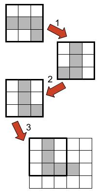
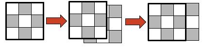

# Image Similarity

**IEEEXtreme 15.0** · Time limit: 4000 ms · Memory limit: 256 MB

**CS Academy:** <https://csacademy.com/ieeextreme-practice/task/image-similarity/>

There are two black-and-white images. You want to determine how similar the two images are by matching their black pixels. Each image has a grid of unit-sized square pixels. You can manipulate the images in the following three ways:

- Rotate one image by $90$ degrees clockwise or counterclockwise;
- Translate an image horizontally or vertically in either direction;
- Flip an image horizontally or vertically.

The /similarity/ between two images is defined as the maximum number of black pixels that can overlap if you manipulate the images using an arbitrary number of the three types of operations above. After all operations, the pixels of the images must be aligned to the unit grid.

Your task is to determine the similarity for a given pair of images.

## Standard input

The first line of the input has a single integer $T$, the number of test cases.

Each test case first describes one image and then the other image. Both images are described in a same format: The first line has two integers $R$ and $C$, the number of pixel rows and columns. The next $R$ lines each have $C$ characters giving one row of pixels. A hash character `#` denotes a black pixel, and a dot character `.` denotes a white pixel.

## Standard output

For each test case, output the similarity of the two images on a single line.

## Constraints and notes

- $1 \leq T \leq 10$
- $1\leq R, C \leq 30$

## Examples

### Example 1

Input:
```
4
3 3
...
###
..#
4 5
.#...
.#...
.###.
.....
3 3
.#.
#.#
.#.
3 3
#.#
.#.
#.#
5 5
#....
.....
.....
....#
..###
5 5
..#..
###..
.....
...##
...#.
1 6
#.#.#.
6 1
#
.
#
.
#
.
```

Output:
```
4
3
4
3
```

Explanation:

There are $4$ test cases in total. The first two are explained below.

- Case $1$: We may apply the following operations in order:
1. Rotate the first image clockwise by $90$ degrees.
1. Flip the first image horizontally.
1. Translate the first image to the top-left corner of the second image.



- Case $2$: we can translate the first image as follows. Note that one image may extend beyond the boundary of the other image when we match the black pixels.


