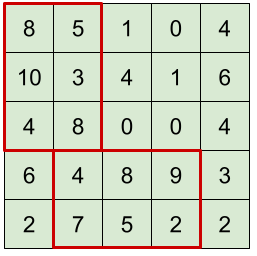

# Maximum Exploitation

**IEEEXtreme 15.0** · Time limit: 2000 ms · Memory limit: 256 MB

**CS Academy:** <https://csacademy.com/ieeextreme-practice/task/exploitation/>

Resource is rich on the Neverwhere Plain. The Neverwhere Plain can be considered a matrix $\mathbf A$ with $R$ rows and $C$ columns. Every element in the matrix is a non-negative integer, representing an amount of resource.

John is planning to build *at most* two plants to collect resource. A plant is a rectangular area with side lengths $X$ and $Y$, where $X$ and $Y$ are pre-selected constant integers. A plant can be built up in either horizontal or vertical direction, which means that its size can be either $X \times Y$ or $Y \times X$. Two plants cannot overlap with each other, but their boundaries can touch. All resource within the range of plants will be exploited.

Help John determine the maximum amount of resource that can be exploited.

## Standard input

The first line of the input has two integers $R$ and $C$ representing the size of the plain. The second line has two positive integers $X$ and $Y$ representing the side lengths of a plant. Then the following $R$ lines give the elements of the plain matrix $\mathbf A$, and each line has $C$ integers.

## Standard output

An integer denoting the maximum amount of resource that John may exploit.

## Constraints and notes

- $1 \leq R, C \leq 1000$
- $0 \leq {\mathbf A}_{ij} \leq 2\,000$
- A plant must be completely within the plain. The size of the plain is large enough for at least one plant to be built. John may build only one plant if there is not enough space for a second plant.
- For $50\%$ of the test files, $1 \leq R, C \leq 50$.

## Examples

### Example 1

Input:
```
5 5
3 2
8 5 1 0 4
10 3 4 1 6
4 8 0 0 4
6 4 8 9 3
2 7 5 2 2
```

Output:
```
73
```

Explanation:

The plant area is $3\times2$ or $2\times3$. The two plants can be built at these locations:



Note that the two plants may have different horizontal/vertical directions.
