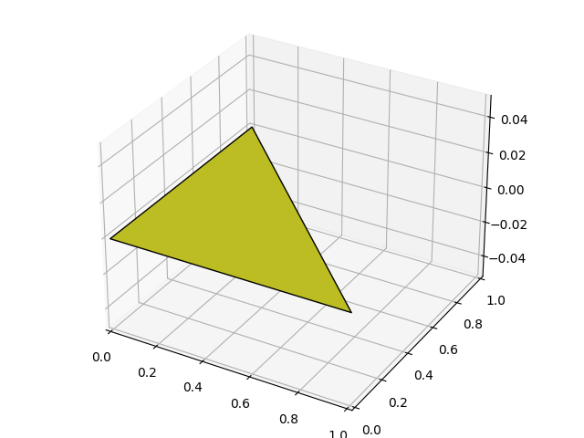
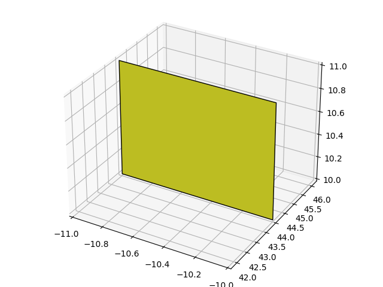
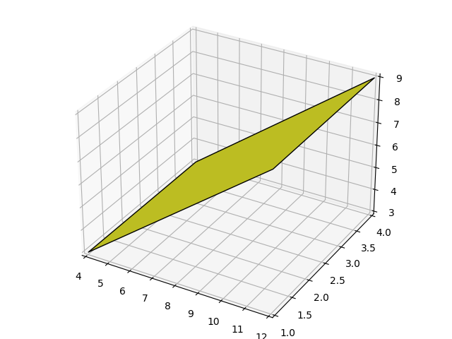
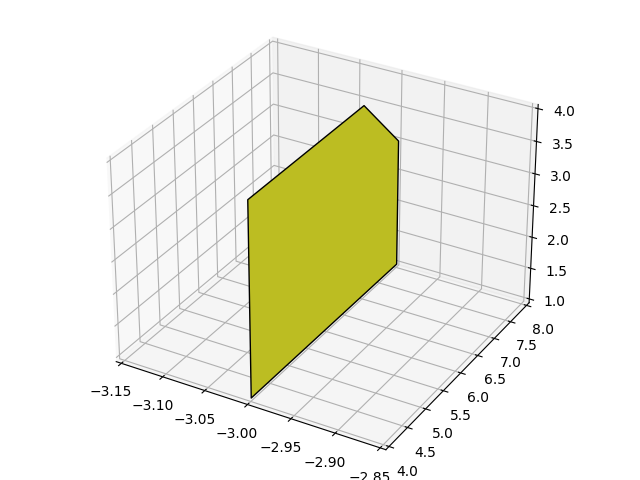
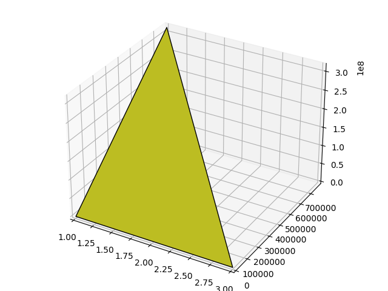
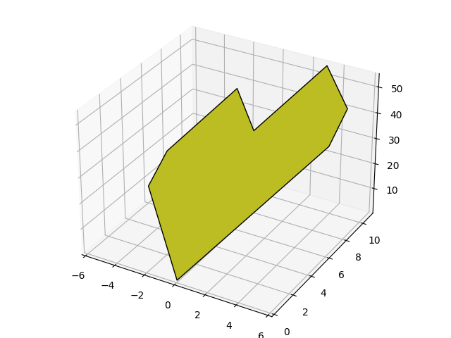
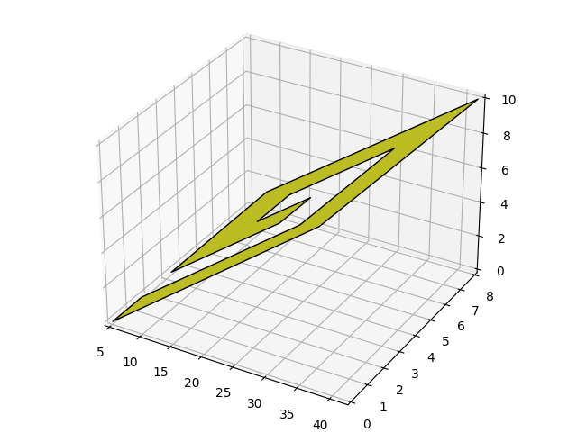
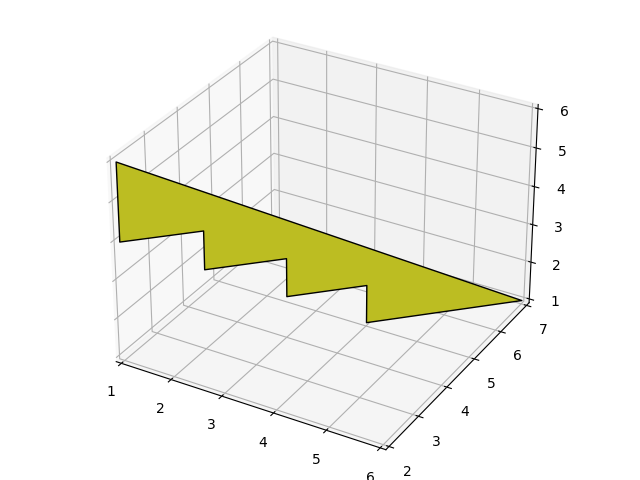
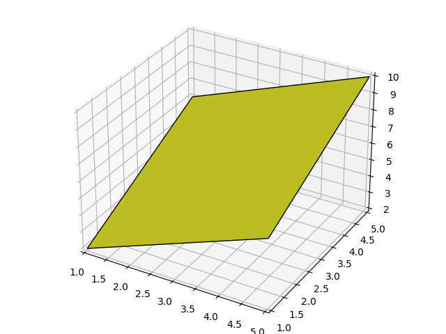

# Polygon

**IEEEXtreme 15.0** · Time limit: 1000 ms · Memory limit: 256 MB

**CS Academy:** <https://csacademy.com/ieeextreme-practice/task/polygon/>

You are given a simple planar polygon in the $3$-dimensional space. Find how many lattice points lie in the polygon's interior. A lattice point is a point that has integer Cartesian coordinates. That is, if the point is at $(x, y, z)$, then $x,y,z$ are all integers. Do not count lattice points on the polygon's boundary.

## Standard input

The first line contains a single integer $T$, the number of test cases.

Each test case contains a single integer $N$ on the first line, the number of vertices of the polygon. The next $N$ lines each have a triplet of integers $x_i$, $y_i$, $z_i$ which represent the X, Y, and Z coordinates of a vertex.

## Standard output

For each test case, output the number of interior lattice points in the polygon on a single line.

## Constraints and notes

- $1 \leq T \leq 10$
- $3 \leq N \leq 10^{3}$
- $10^{-9} \leq x_i, y_i, z_i \leq 10^{9}$
- The input vertices are given in the order of walking the polygon edges.
- The polygon is planar: it lies in a 2D plane.
- The polygon is simple: its edges have no intersection except that adjacent edges share a vertex.
- The polygon is non-degenerate: It has non-zero area.

## Examples

### Example 1

Input:
```
3
3
0 0 0
0 1 0
1 0 0
4
-10 44 10
-10 44 11
-11 44 11
-11 44 10
4
4 4 3
12 4 9
12 1 9
4 1 3
```

Output:
```
0
0
2
```

Explanation:

There are three test cases:

- Case $1$: The polygon is a smallest right triangle in XY plane, which does not have any interior lattice point.



- Case $2$: The polygon is a smallest square in a plane parallel to the XZ plane, which also does not have any interior lattice point.



- Case $3$: The polygon is a $3\times10$ rectangle on an inclined plane. It has $2$ ($2\times 1$) interior lattice points.



### Example 2

Input:
```
3
5
-3 4 4
-3 7 4
-3 8 3
-3 8 1
-3 4 1
3
1 0 0
1 785300 314159265
3 0 0
8
0 0 1
6 6 43
6 8 51
3 11 54
0 8 33
-3 11 36
-6 8 15
-6 6 7
```

Output:
```
6
19632
65
```

Explanation:

- Case $1$: The polygon is a $4\times3$ rectangle on a plane parallel to YZ plane, but with one trimmed corner. It has $6$ ($2\times3$) interior lattice points.



- Case $2$: The polygon is a very tall triangle. Only the bottom half contains interior lattice points - one per line.



- Case $3$: The polygon is a heart shaped non-convex polygon with $65$ interior lattice points.



### Example 3

Input:
```
3
12
5 0 0
10 0 2
19 6 2
34 6 8
28 2 8
23 2 6
26 4 6
21 4 4
15 0 4
30 0 10
42 8 10
17 8 0
9
1 2 6
1 2 4
2 3 4
2 3 3
3 4 3
3 4 2
4 5 2
4 5 1
6 7 1
5
1 1 2
1 3 4
1 5 6
5 5 10
5 1 6
```

Output:
```
14
0
9
```

Explanation:

- Case $1$: The polygon is a spiral with $14$ interior lattice points. Note that there are $6$ lattice points within the convex hull of the shape that are outside the polygon.



- Case $2$: The polygon is a staircase with no interior lattice points.



- Case $3$: The polygon is a degenerate pentagon - actually a square with $9$ interior lattice points.


