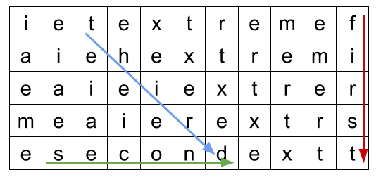

# Word Search

**IEEEXtreme 15.0** · Time limit: 4000 ms · Memory limit: 256 MB

**CS Academy:** <https://csacademy.com/ieeextreme-practice/task/wordsearch/>

A /word search/ is a game that consists of the letters of words placed in a grid of $R$ rows and $C$ columns. Each cell of the grid has a lowercase letter (`a-z`). A list of /search words/ is provided. The objective of this game is to find and mark all the search words hidden inside the grid. The words may be placed horizontally, vertically, diagonally, anti-diagonally, or in reverse in any of these directions.

Rows of the grid are numbered $0$ to $R - 1$ from top to bottom, and columns of the grid are numbered $0$ to $C - 1$ from left to right. Each cell in the grid is identified by its row and cell $(r, c)$. A search word is said to appear at $(r_s, c_s, r_e, c_e)$ if its first letter is at cell $(r_s, c_s)$, and its last letter is at cell $(r_e, c_e)$. Since words may appear in reverse, it is possible that $r_e < r_s$ or $c_e < c_s$.

## Standard input

The first line of the input file has three integers $R, C, Q$, where $R, C$ give the size of the grid, and $Q$ is the number of search words. The next $R$ lines each have $C$ lowercase letters describing one row of the grid. The next $Q$ lines each have a search word.

## Standard output

For each search word in order, output its location (identified by $r_s, c_s, r_e, c_e$) in the grid.

If a search word exists more than once in the grid, output the location with the smallest $r_s$. Ties are to be broken by finding the location with the smallest $c_s$, then $r_e$, and finally $c_e$.

If a search word does not exist in the grid, output $-1$.

## Constraints and notes

- $1 \leq R, C, Q \leq 100$
- All search words contain at least $2$ and at most $max(R, C)$ characters.

## Examples

### Example 1

Input:
```
5 11 4
ietextremef
aiehextremi
eaieiextrer
meaierextrs
esecondextt
first
second
third
fourth
```

Output:
```
0 10 4 10
4 1 4 6
0 2 4 6
-1
```

Explanation:

There are $4$ queries words. The first $3$ words can be found in the grid:



- The word `first` starts at row $0$ column $10$, and ends at row $4$ column $10$ (shown in red).
- The word `second` starts at row $4$ column $1$, and ends at row $4$ column $6$ (shown in green).
- The word `third` starts at row $0$ column $2$, and ends at row $4$ column $6$ (shown in blue).
- The word `fourth` does not appear in the grid.

### Example 2

Input:
```
4 6 4
xtreme
xtreme
xtreme
iiiiii
xtreme
ieee
eme
ie
```

Output:
```
0 0 0 5
3 3 0 3
0 3 0 5
3 2 2 3
```

Explanation:

Do not forget to handle reverse order. Make sure that you break the ties correctly.
