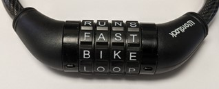

# Combo Locks

**IEEEXtreme 16.0** · Time limit: 1000 ms · Memory limit: 256 MB

**CS Academy:** <https://csacademy.com/ieeextreme-practice/task/combo-locks/>

In this challenge, you will design a combination lock, with 8 wheels that contain letters. The image below shows an example of such a lock with four wheels.

The goal is to choose the letters for each wheel so that you can make as many words as possible from the list at the bottom of this challenge.  Each wheel contains ten lowercase letters, or a space. If a space is available on the last wheel, in addition to 8 letter words, you can make 7 letter words by choosing a space as the last letter. Similarly, if a space is available on the last two wheels, you can make 6, 7, or 8 letter words, and so on.

## Standard input

The input file is blank.  You will be processing the file below offline, and submitting a simple program that just produces output.

## Standard output

Output should consist of eight lines, each of which should contain 9 or 10 lowercase letters.  The first line should contain the letters for the first wheel of the lock, the second should contain letters second wheel, etc. If you wish to include a space on a wheel, you should output only 9 letters for a line.

## Constraints and notes

Your submission will score a zero, if any of the following constraints are violated:

- Every line must contain 9 or 10 lowercase letters.
- If a line contains 9 lowercase letters, all lines after that one should also contain 9 lowercase letters.
- There must be exactly 8 lines of output.

Otherwise, your score will be equal to:

- $(\frac{\text{Your Answer}}{\text{Best Answer}})^8 * \text{Task Score}$, where $\text{Best Answer}$ is the largest valid answer among all competition submissions, and $\text{Your Answer}$ is the number of words your submission can make.

There will be a single test case, you can download the file here: [input.txt](https://publicmedia1.csacademy.com/public/1665872079-1764353739.txt)

Note: The word list contains the words with 8 characters or fewer from the list at [Google 10,000 Most Common English Words, No Swears](https://github.com/first20hours/google-10000-english/blob/master/google-10000-english-no-swears.txt).
