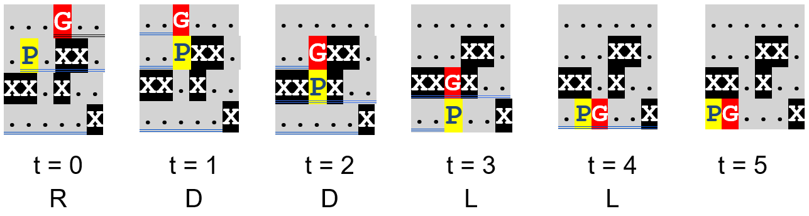
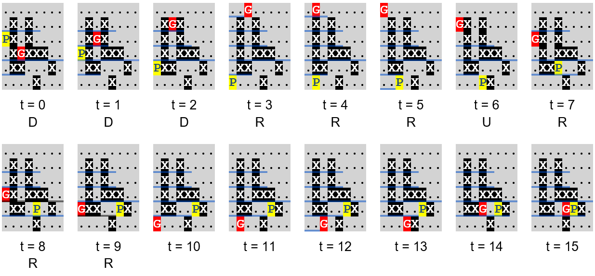

# Invisible Ghosts

**IEEEXtreme 16.0** · Time limit: 3000 ms · Memory limit: 515 MB

**CS Academy:** <https://csacademy.com/ieeextreme-practice/task/invisible-ghosts/>

Pac-Man is a maze chase video game that was very popular in the 1980s; it is possibly one of the most influential video games of all time. You don’t need to look it up or be familiar with it to solve this task, although you may want to do it, in due time.

Your friend Pac-Man hides in a maze. A number of ghosts are after him and Pac-Man tries to avoid being caught. The maze is represented by a rectangular grid that consists of $N \times M$ cells ($N$ rows, $M$ columns). Each cell contains one of the following characters:

- "P"	Pac-Man’s initial position.
- "G"	The initial position of a ghost.
- "."	The cell is empty.
- "Χ"	The cell is occupied by an obstacle; neither Pac-Man nor the ghosts can go there.

In every time unit, Pac-Man and the ghosts can either stay still or move to one of the cells that are adjacent to their current position (left, right, up or down). If, at some moment in time, a ghost reaches the cell that Pac-Man is in, your friend is doomed and the game ends.

To make things even harder for Pac-Man, in our version of the game, the ghosts become invisible once the game starts! Pac-Man’s goal is to survive for the longest time possible, based only on his knowledge of the ghosts’ initial positions.

Pac-Man needs your help to answer two questions:

1) What is the latest possible time that he is guaranteed to be safe?

2) What is the optimal path that he can use to achieve this?

The answer to the first question is either a non-negative integer number, or the word "INFINITE", in case there are no ghosts or the ghosts cannot reach Pac-Man because of the obstacles.

The answer to the second question is a string representing the optimal path as a sequence of moves, consisting of the letters "L", "R", "U" and "D" (left, right, up and down). An empty sequence of moves, leaving Pac-Man in his initial position, is represented by the word "STAY". If multiple optimal paths exist that are guaranteed to keep Pac-Man safe until the latest possible time, then:

(a) Pac-Man prefers the one that ends in the cell with the lexicographically smaller pair of coordinates (row, column). The upper-left corner of the grid has the lexicographically smallest pair of coordinates.

(b) If there are multiple optimal paths satisfying (a), Pac-Man prefers the one with the shortest sequence of moves. For example, the sequences "D" and "RDL" both move Pac-Man one cell down; he prefers the first because it is shorter. (Remember that "STAY" denotes a sequence of zero moves.  Note that you do not append "STAY" to a non-empty sequence of moves, even if Pac-Man stops at the ending position.)

(c) If there are multiple optimal paths satisfying both (a) and (b), Pac-Man prefers the lexicographically smallest sequence of moves. For example, all three sequences "DDR", "DRD" and "RDD" move Pac-Man two cells down and one cell to the right and they have the same length; he prefers "DDR", which is the lexicographically smallest of the three.

## Standard input

The first line of the input contains an integer $T$: the number of test cases that follow. Each of the test cases begins with a line containing two integers, $N$ and $M$, separated by a single space: the dimensions of this test case's grid. $N$ lines follow, each containing $M$ characters among the ones listed above and representing one row of the grid.

## Standard output

Your program must print $T$ lines, one for each test case, in the order they are given. The line corresponding to the $k^{th}$ test case ($1 ≤ k ≤ T$) should contain: "Case #k: ANSWER1 ANSWER2", where ANSWER1 and ANSWER2 are the answers to the two questions, as described above.

## Constraints and notes

- $1 \leq T \leq 10$
- $1 \leq Ν \leq 500, 1 \leq Μ \leq 500$

## Examples

### Example 1

Input:
```
4
2 4
P...
....
4 6
...G..
.P.XX.
XX.X..
.....X
6 8
........
.X.X....
PX.X....
.XGXXX..
.XX...X.
....X...
8 11
GX..XX....G
.X..X..XG..
.X.........
...XX......
XXX.GX.....
..X.....XXX
...XXX..XG.
..P..X.X...
```

Output:
```
Case #1: INFINITE STAY
Case #2: 5 RDDLL
Case #3: 15 DDDRRRURR
Case #4: INFINITE LLUU
```

In the first test case, Pac-Man is safe as there are no ghosts. He is already in the cell with the lexicographically smallest coordinates (the upper-left corner); therefore, he doesn’t need to move.

For the second test case, the preferred optimal path for Pac-Man is shown below. The ghost may be chasing him to the lower-left corner, where Pac-Man arrives at t=5. The ghost would catch him at t=6. Notice that it would not have been safer for Pac-Man at t=3 to go right instead of left, as the ghost could have chosen to go right instead of left at t=0. In that case, the ghost would again catch him at t=6 but at t=5, Pac-Man would be in a different cell with lexicographically larger coordinates.



For the third and most interesting test case, the preferred optimal path is again shown below.



Notice that the ghost may reach Pac-Man’s final position at t=16. If the ghost had chosen to go right instead of left at t=3, it would again reach the final position at t=16. Therefore, Pac-Man is safe there until t=15 in both cases and, not being able to see the ghost’s movement, this is the longest he is guaranteed to stay safe.

In the fourth test case, Pac-Man is safe because the ghosts cannot reach him. He should move to the cell with the lexicographically smallest coordinates that he can reach, following the sequence of four moves “LLUU” (he could also get there with “ULUL” but “LLUU” is lexicographically smaller).
