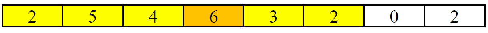
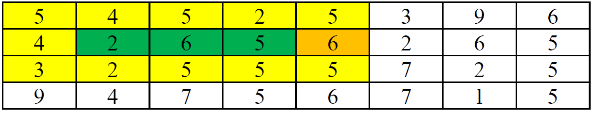

# Outpost

**IEEEXtreme 16.0** · Time limit: 1000 ms · Memory limit: 256 MB

**CS Academy:** <https://csacademy.com/ieeextreme-practice/task/outpost/>

During the combat against Zerg, Terran is planning to set up an outpost on the narrow and long bridge between the two sides of Neverwhere Canyon. Your task is to help Terran select the best rectangular area on this natural bridge as the outpost.

The surface of the bridge can be considered as a fat matrix or a 2D-array $A$, with a size of $m \times n$. As a natural bridge, ups and downs can be observed. Entries of the matrix indicate the altitude. For simplification purposes, the entries are non-negative integers.

An outpost $O$ is in a rectangular area paralleling the edges of the matrix $A$ and can only be established on a relatively flat area. The highest and lowest elevation within the outpost area cannot exceed a given threshold $t$. In a mathematics statement,

$max_{(i,j) \in O}A_{ij} - min_{(i,j) \in O} A_{ij} \le t, O=\{(i,j) | x_0 \le i \le x_1, y_0 \le j \le y_1\}$

In addition, in order to set up sentinels and flags, the perimeter of the outpost must contain a point with maximum elevation in the outpost area.

Terran wants to set up the outpost with the maximum possible area given the above requirements.

## Standard input

The first row of the input has three integers representing narrow bridge size $m$, $n$, and the tolerated maximum altitude difference $t$. Then, the following $m$ rows each have $n$ integers representing the matrix $A$, which indicates each point's altitude.

## Standard output

An integer for the maximum area of a legal outpost should be the output.

## Constraints and notes

- $0 \le A_{ij} \le 10^9$
- $0 \le t \le 10^9$
- For 30% of the test cases, $m = 1$ AND $n \le 50000$.
- In the remaining test cases, $m \lt n$ and $m \le 10$ and $n \le 5000$.

## Examples

### Example 1

Input:
```
1 8 4
2 5 4 6 3 2 0 2
```

Output:
```
6
```

Explanation:

The maximum outpost is shown below. The highest (6) minus the lowest (2) is less than or equal to the given threshold (4). Since it is a row when $m = 1$, each entry in the outpost is on the edge of the outpost.

 

### Example 2

Input:
```
4 8 4
5 4 5 2 5 3 9 6
4 2 6 5 6 2 6 5
3 2 5 5 5 7 2 5
9 4 7 5 6 7 1 5
```

Output:
```
15
```

Explanation:

The maximum outpost is shown below. The highest (6) minus the lowest (2) is less than or equal to the given threshold (4). Note that the maximum elevation, 6, is present in an entry on the perimeter of the outpost.

 
