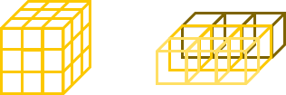
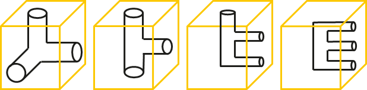
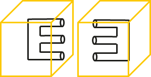
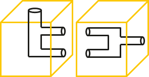
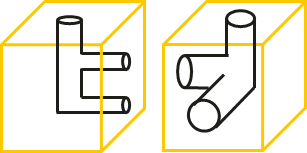
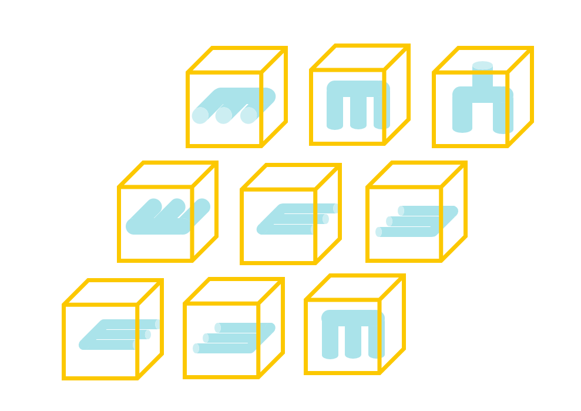
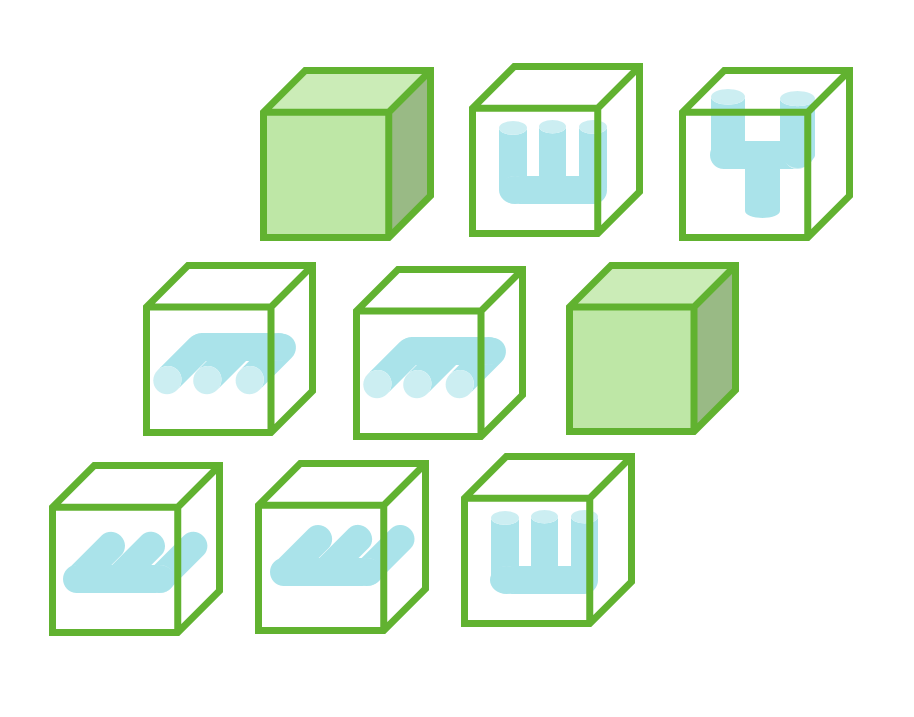
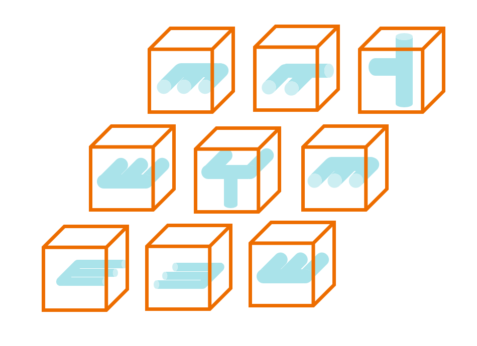

# Pipeline

**IEEEXtreme 16.0** · Time limit: 5000 ms · Memory limit: 512 MB

**CS Academy:** <https://csacademy.com/ieeextreme-practice/task/pipeline/>

*This problem was co-authored by Huawei.*

This is an era of extreme weather, and many cities are at a loss in the face of strong storms. When the heavy rainfall comes, the city's drainage system must prevent disasters brought by flooding, which brings great harm to people's lives and property. In this challenge, you will determine if it is possible to design a drainage pipe network meets all the requirements stated below.

The underground space of the city can be viewed as a rectangular cuboid of length $N$, width $M$, and depth $D$. A rectangular cuboid consists of $N \times M \times D$ cubic units, each of which is a small cube with dimensions $1 \times 1 \times 1$.

Here is a $N=3, M=3, D=3$ rectangular cuboid and one layer in it:



Each empty cubic unit will have a drainage pipe. Each drainage pipe has only three nozzles, and they can be oriented in whatever way you would like.  Some examples are shown in the figure below.



There are three types of cubic units:

- Block: *No pipe can be buried*. Denoted by `#`
- Space: *Must have pipes buried within*. Denoted by `*`
- Water inlet/outlet: Appears only on the first and last layers. Denoted by `o`. The water inlet is on the top of the first layer and the water outlet is at the bottom of the last layer. The requirement at the top layer is that the water inlet must have *only one* nozzle on the top surface, and at the bottom surface, the water outlet must have *only one* nozzle on the bottom surface.

Every small cubic unit, that can have pipes buried within, must have pipes buried within. And you need to make sure that the number of nozzles on two adjacent faces must be equal in order to make it easier to connect. At the same time, to simplify the problem, it is only necessary to ensure that the quantities are the same, regardless of whether the shapes of the nozzles are the same.

Here are some examples of connections:

*Legal:*



*Legal:*



*Illegal:*



## Standard input

The first line contains one integer $T$ — the number of test cases in input.

The first line of each case contains three integers $N, M, D$ — length, width, and depth of the rectangular cuboid.

Next there are $N \times M$ matrices for each of the $D$ levels. The level appears on $N$ lines with $M$ characters each. Each character of a matrix is either `*`, `#` or `o`.  After each level of the matrix, there is a blank line.

## Standard Output

Output $T$ lines, each of which contains an evaluation of the corresponding test case.  For each case, if it is possible to create a design that meets all the requirements, output `YES`, else output `NO`.

## Constraints and notes

- $1 \leq T \leq 15$
- $1 \leq N, M \leq 50$
- $2\leq D \leq 50$
- $\sum N \times M \times D \leq 100,000$

Notes:

1. No nozzles are allowed on surfaces that are not adjacent to any other small cubic unit except for the inlet and outlet.
1. The water inlet and the water outlet do not necessarily need to be connected.
1. A closed area consisting of multiple pipes is permitted (as shown in the first legal connection example).

## Examples

### Example 1

Input:
```
1
3 3 3
**o
***
***

#**
**#
***

**o
*o*
***
```

Output:
```
YES
```

One of the feasible drainage designs is shown below.

The first layer:



The second layer:



The third layer:


