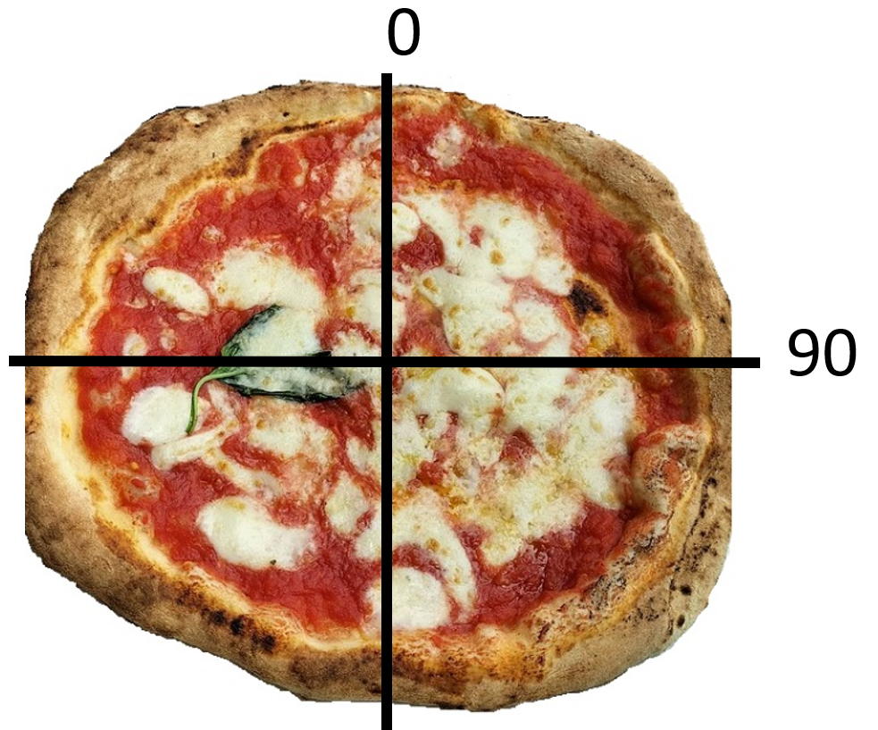
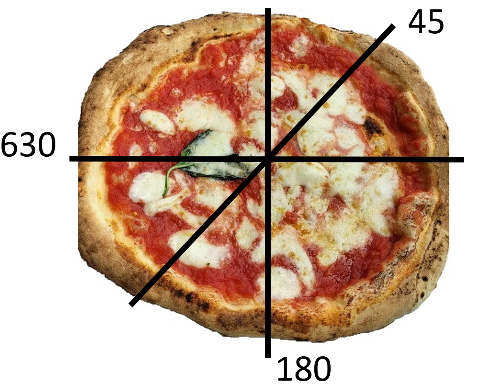

# Pizza Cutter

**IEEEXtreme 16.0** · Time limit: 1000 ms · Memory limit: 256 MB

**CS Academy:** <https://csacademy.com/ieeextreme-practice/task/pizza-cutter/>

The slicematic is a pizza cutting robot.  The robot takes a series of degree offsets as inputs and uses these to slice the pizza along the diameter starting at each offset.  Your task is to count the number of pieces of pizza that will result after the robot is done cutting. The image below shows some example offsets. The first image results in 4 pieces, and the second has 6 pieces.





Notes:

- As shown in the image above, the slicematic robot can take degree values that are more than $360$ degrees.
- The positive degree value represents clockwise rotation, as shown in the images.  The robot can also take a negative value as a degree, representing counterclockwise rotation.
- If the robot makes two equivalent slicing offsets, e.g., $0$ and $180$, only one cut will be made.
- All slices will intersect in the center of the pizza.

## Standard input

The first line of input contains a single integer $T$, the number of test cases.

Each test case is a single line of space-separated integers.  The testcase begins with an integer $N$, which is the number of slicing offsets in the test, followed by $N$ integers, $D_1$, $D_2$, ..., $D_n$, each describing an offset the robot will use to slice a pizza.

## Standard output

For each test case, output a single line containing the number of pieces of pizza that will result after the slicematic makes all of the slices.

## Constraints and notes

- $1 \leq T \leq 30$
- $0 \leq N \leq 10^4$
- $-10^6 \leq D_i \leq 10^6$, for all $i, 1 \leq i \leq N$

### Getting Started

If this is your first programming contest, the following code may be helpful to get you started.

Input for this problem is read via standard input.  The only output you should produce is the final answer.  For example, to read the input in Java, you could use the following code:

```
// Don't place your source in a package
import java.util.*;
import java.lang.*;
import java.io.*;

// Please name your class Main
class Main {
	public static void main (String[] args) throws java.lang.Exception {
        Scanner sc = new Scanner(System.in);
        
        // Read the number of testcases
        int T = sc.nextInt();
        // Process each test case
        for (int t = 0; t < T; t++) {
            // Read the number of offsets
            int N = sc.nextInt();
        	
            int answer = 0;
            // Read each offset
            // TODO: You will need to figure out how to
            // process the offset and change the variable answer
            for (int n = 0; n < N; n++) {
                int D = sc.nextInt();	
            }
        	
            // Output your answer:
            System.out.println(answer);
        }

	}
}
```

Equivalently in Python, you could write:

```
# a simple parser for python. use get_number() and get_word() to read
def parser():
    while 1:
        data = list(input().split(' '))
        for number in data:
            if len(number) > 0:
                yield(number)   

input_parser = parser()

def get_word():
    global input_parser
    return next(input_parser)

def get_number():
    data = get_word()
    try:
        return int(data)
    except ValueError:
        return float(data)

# numpy and scipy are available for use
import numpy
import scipy

# Read the number of testcases
T = get_number()

# Process each test case
for t in range(T):
    N = get_number()

    answer = 0
    # Read each offset
    # TODO: You will need to figure out how to
    # process the offset and change the variable answer
    for n in range(N):
        D = get_number()
	
    # Output your answer
	print(answer)
```

## Examples

### Example 1

Input:
```
4
2 0 90
3 45 180 630
3 90 -90 270
0
```

Output:
```
4
6
2
1
```

Explanation:

There are $4$ test cases.

Case $1$: This corresponds to the first image above where there are two cuts at $0$ degrees and $90$ degrees.  This results in $4$ pieces of pizza.

Case $2$: This corresponds to the second image above where there are three cuts at $45$, $180$, and $630$ degrees.  This results in $6$ pieces of pizza.

Case $3$: Here all of the offsets, $90$, $-90$, and $270$, correspond to the same cut of the pizza.  Thus, there are two slices.

Case $4$: Here there are no cuts made by the robot, so there is only one piece of pizza.
