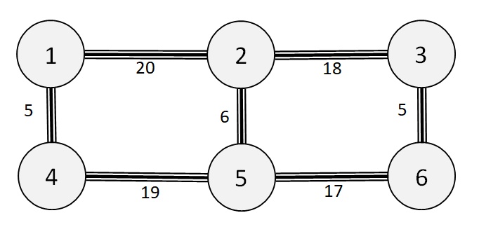

# Tourist Taxi Service

**IEEEXtreme 16.0** · Time limit: 1000 ms · Memory limit: 256 MB

**CS Academy:** <https://csacademy.com/ieeextreme-practice/task/tourist-taxi-service/>

*This problem is sponsored by Huawei.*

Bob runs a taxi service that caters to tourists.  He guarantees that all of his rides will begin with five unique streets in his historic city.  Otherwise, his rides will be the shortest possible to a destination given this constraint.  Your task is to find the length of time for all possible rides starting at a fixed location.

## Standard input

Each input has a single test case.

The first line of input contains a single integer $N$, which gives the number of intersections in the city.  Intersections are numbered $1$ through $N$. All trips start at intersection $1$.

The next line contains a single integer $M$ which gives the number of streets in the city.

The following $M$ lines contain three integers $S$, $D$, and $L$, and describe a two-way street that connects intersections $S$ and $D$, with a time needed to traverse the street of $L$ units.

## Standard output

The output will contain $N$ lines, each with a single integer.  The $i^{th}$ line will be the length of the shortest path from intersection $1$ to intersection $i$, which begins with 5 unique streets.

## Constraints and notes

- $4 \leq N \leq 10^4$
- $5 \leq M \leq 2 * 10^4$
- $1 \leq L_i \leq 10^5$
- $1 <= S_i, D_i <= N$
- Each intersection will be connected to at most $4$ streets.
- It is guaranteed that any intersection can be reached from intersection 1.
- The street $(S_i, D_i)$ is guaranteed to be unique in the input.
- It is guaranteed that there will always be paths that start with 5 distinct streets.

## Examples

### Example 1

Input:
```
6
7
5 6 17
1 2 20
1 4 5
5 4 19
6 3 5
2 3 18
2 5 6
```

Output:
```
84
64
58
79
70
53
```

The test case corresponds to the map in the image below.  The intersections are the circles, and the lines are the streets, with the lengths that are given.



The shortest trips to each intersection, which start with five unique streets, are as follows:

1: 84, via 1->2->3->6->5->4->1

2: 64, via 1->4->5->6->3->2

3: 58, via 1->4->5->2->3->6->3

4: 79, via 1->2->3->6->5->4

5: 70, via 1->4->5->2->3->6->5

6: 53, via 1->4->5->2->3->6
