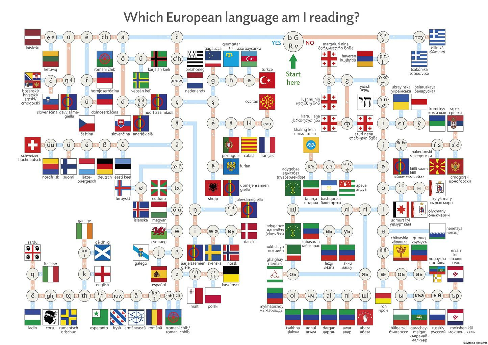

# What Language Am I Speaking?

**IEEEXtreme 16.0** · Time limit: 2000 ms · Memory limit: 256 MB

**CS Academy:** <https://csacademy.com/ieeextreme-practice/task/what-language-am-i-speaking/>

The decision tree below can be used to determine the language used in a phrase based on the characters present in the text.  If a character is present in the text, we should follow the "YES" branch of the tree.  However, if a character is not present, it may be because it is simply not present in the phrase.  Therefore, the language might be in either the "YES" or the "NO" branch of the tree.



Your task in this challenge is to determine the language that might be used based on a simpler type of decision tree.

## Standard input

The first line of input contains two space-separated integers $n,p$, where $n$ is the number of nodes in the decision tree, and $p$ is the number of phrases that we must analyze.

The next $n$ lines describe a node in a tree.

If the node is an internal node, it will have the following format:  `I [id] [character] [YES_id] [NO_id]`, where `[id]` is an integer that uniquely identifies the node, `[character]` is a single character, `[YES_ID]` is the id of the child node on the "YES" branch, and `[NO_id]` is the id of the child node on the "NO" branch.  The presence or absence of `[character]` in a phrase determines which branch or branches you should follow.

If the node is a leaf node, it will have the following format:  `L [id] [language]`, where `[id]` is an integer that uniquely identifies the node, and `[language]` is the name of the language in the leaf.

The next $p$ lines contain phrases that should be analyzed.

## Standard output

For each phrase, output a list of languages that the phrase could be using, according to the decision tree. The list should be output in alphabetical order.

## Constraints and notes

- $0 \leq n \leq 10^4$
- $0 \leq p \leq 10^4$
- $1 \leq id \leq 10^7$, for all $id$'s
- The name of each language will contain an initial capital and the rest of the characters will be lowercase letters.  The length of a language name will be no more than 20 characters.
- Each phrase will be at most 1000 characters.
- The input files are encoded using UTF-8 encoding.
- If two characters have different UTF-8 encodings, they should be considered distinct.  For example, "A" (UTF-8 character 0x41) is not the same as "a" (UTF-8 character 0x61). Similarly, "ĸ" (UTF-8 character 0x138) is not the same as "κ" (UTF-8 character 0x3BA).

## Examples

### Example 1

Input:
```
7 2
I 1 é 2 3
I 2 ñ 4 5
I 3 π 6 7
L 4 Spanish
L 5 French
L 6 Greek
L 7 English
después de un año
un año
```

Output:
```
Spanish
English Greek Spanish
```

Explanation:

In this input, we have a tree that looks like the following:

<Graph indexType="custom" height="400" width="400"

nodes={[

{options:{circleAttr:{radius:25},fixed:true},label:"é",center:{x:190.8,y:76.9}},

{options:{circleAttr:{radius:25},fixed:true},label:"ñ",center:{x:90.8,y:192.3}},

{options:{circleAttr:{radius:25},fixed:true},label:"π",center:{x:290.8,y:192.3}},

{options:{circleAttr:{radius:32},fixed:true},label:"Spanish",center:{x:40.8,y:307.7}},

{options:{circleAttr:{radius:32},fixed:true},label:"French",center:{x:140.8,y:307.7}},

{options:{circleAttr:{radius:32},fixed:true},label:"Greek",center:{x:240.8,y:307.7}},

{options:{circleAttr:{radius:32},fixed:true},label:"English",center:{x:340.8,y:307.7}}

]}

edges={[

{label:"Yes",source:0,target:1},{label:"No",source:0,target:2},

{label:"Yes",source:1,target:3},{label:"No",source:1,target:4},

{label:"Yes",source:2,target:5},{label:"No",source:2,target:6}

]}

/>

The phrase "después de un año" must be in Spanish according to the tree, since neither Greek nor English use the é character, and French does not use the ñ character.

The phrase "un año" could be in English, Greek, or Spanish, since we cannot be sure, based on the tree, that Greek and English do not use the ñ symbol.

### Example 2

Input:
```
11 4
L 2 Hindi
L 7 Chinese
I 11 и 3 13
I 13 á 5 19
L 3 Ukranian
L 19 English
I 17 न 2 31
L 5 Portugese
I 31 你 23 11
I 23 こ 29 7
L 29 Japanese
नमस्ते
你好
привіт
olá
```

Output:
```
Hindi
Chinese Hindi Japanese
Chinese Hindi Japanese Ukranian
Chinese Hindi Japanese Portugese Ukranian
```

Explanation:

In the second sample input, note that the nodes appear in an arbitrary order. We have a tree that looks like the following:

<Graph indexType="custom" height="420" width="500"

nodes={[

{options:{circleAttr:{radius:25},fixed:true},label:"न",center:{x:150,y:27}},

{options:{circleAttr:{radius:32},fixed:true},label:"Hindi",center:{x:50,y:111.2}},

{options:{circleAttr:{radius:25},fixed:true},label:"你",center:{x:230,y:111.2}},

{options:{circleAttr:{radius:25},fixed:true},label:"こ",center:{x:130,y:197.5}},

{options:{circleAttr:{radius:32},fixed:true},label:"Japanese",center:{x:90,y:283.8}},

{options:{circleAttr:{radius:25},fixed:true},label:"и",center:{x:310,y:197.5}},

{options:{circleAttr:{radius:32},fixed:true},label:"Ukrainian",center:{x:260,y:283.8}},

{options:{circleAttr:{radius:25},fixed:true},label:"á",center:{x:385,y:283.8}},

{options:{circleAttr:{radius:32},fixed:true},label:"Portug.",center:{x:310,y:370.1}},

{options:{circleAttr:{radius:32},fixed:true},label:"English",center:{x:465,y:370.1}},

{options:{circleAttr:{radius:32},fixed:true},label:"Chinese",center:{x:170,y:283.8}}]}

edges={[

{label:"Yes",source:0,target:1},

{label:"Yes",source:2,target:3},

{label:"Yes",source:3,target:4},

{label:"No",source:0,target:2},

{label:"No",source:2,target:5},

{label:"Yes",source:5,target:6},

{label:"No",source:5,target:7},

{label:"Yes",source:7,target:8},

{label:"No",source:7,target:9},

{label:"No",source:3,target:10}

]}

/>
