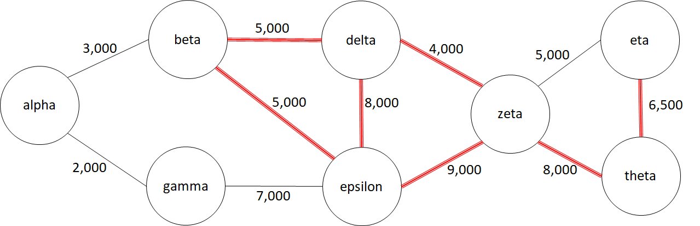
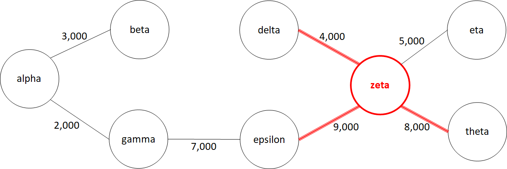

# Wireless Network

**IEEEXtreme 16.0** · Time limit: 3000 ms · Memory limit: 256 MB

**CS Academy:** <https://csacademy.com/ieeextreme-practice/task/wireless-network/>

We have been given the task of designing a wireless network for a rural area.  The network will be comprised of microwave links.  Because of the rugged terrain, some towers will need to be upgraded.  Our goal is to find a network that allows a direct or indirect connection between any two cities, with as cheap a cost as possible.

## Standard input

The input consists of a single testcase.

The input begins with an integer $n$ that gives the number of microwave links that could be built.

The next $n$ lines describe each of the potential links, with 4 space-separated values $t_1$, $t_2$, $c$, $h$.  $t_1$ and $t_2$ are the names of the locations for the towers. $c$ is an integer that gives the cost for constructing a link between the two distinct towers $t_1$ and $t_2$. $h$ is equal to 1 if at least one of the two towers needs to be an upgraded tower in order for this link to be used, and 0 if neither towers needs to be an upgraded tower.  It costs 10,000 to upgrade a tower.

## Standard output

Output consists of a single line that provides the cost of the cheapest network possible, that provides a way to communicate, either directly or indirectly, between any two towers.

## Constraints and notes

- $1 \leq n \leq 1,000$
- $1 \leq c \leq 100,000$

The tower names will be alphanumeric strings with between 1 and 10 characters, inclusive.  No two towers will have the same name.

It is guaranteed that you will be able to create a network that provides a path between any pair of towers.

Every link is bidirectional, and will only be listed once in the input.  For example, the input will NOT contain information about a potential link between $towerA$ and $towerB$, and another line with information about a potential link between $towerB$ and $towerA$.

At most 12 towers will be involved in links that require an upgraded tower.

## Examples

### Example 1

Input:
```
11
alpha beta 3000 0
alpha gamma 2000 0
gamma epsilon 7000 0
beta delta 5000 1
delta epsilon 8000 1
beta epsilon 5000 1
epsilon zeta 9000 1
zeta delta 4000 1
zeta eta 5000 0
zeta theta 8000 1
eta theta 6500 1
```

Output:
```
48000
```

The network corresponds to the one in the image below.  The edges requiring an upgraded tower are shown in red.



The cheapest network can be created by making an upgraded tower at $zeta$ and choosing the links in the image below.  This network costs 48,000.


