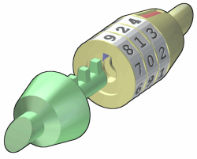

# Combo Lock Redux

**IEEEXtreme 17.0** · Time limit: 3000 ms · Memory limit: 256 MB

**CS Academy:** <https://csacademy.com/ieeextreme-practice/task/combo_locks/>

Xtreme Locks, Inc. is developing electronic versions of combination locks, like the one shown below.



The lock is made up of $n$ wheels, with each wheel containing the numbers 0 through 9. In the electronic version of the lock, you can turn any wheel one position at a time.  Since the numbers of the wheels wraparound, on a 3-wheel lock you can move from 000 to any of the following positions: 001, 010, 100, 009, 090, or 900.

The electronic version of the lock always starts at all zeros. To unlock the lock, you must change the lock to a target code, AND each position that you pass through on the way to the target code must be on the list of allowable positions.

The list of allowable positions is generated from a sequence defined as:

	$h_i = (a \times h_{i-1} + b)$ mod $q$

The ith allowable code is calculated by taking $h_i$ mod $10^n$, where $n$ is the number of wheels in the lock.

Note that as soon as the target code is reachable from the starting position, the sequence is terminated.

Your task in this challenge is to evaluate whether it is possible to reach the target code for a given lock. If it is possible, you will also determine the minimum number of changes needed to reach the target, and the number of distinct ways to reach the target using the minimum number of changes.  Since the number of distinct ways to reach the target may be large, you should output the count modulo $(10^9+9)$.

## Standard Input

Input begins with an integer $c$ on a line by itself that indicates how many lock configurations are provided.

Each of the next $c$ lines are in the form:

  `n t h_0 a b q`

where:

- `n` gives the number of wheels in the lock.
- `t` is a n-digit string giving the target code
- `h_0` provides the first value for the sequence of allowable values.  Note that an allowable value should be generated from `h_0`.
- `a, b, q` are the values used to calculate the sequence of allowable values, as described above.

## Standard Output

For each lock configuration output either:

- `-1` if there is no way to reach the end code with the sequence of allowable values, or
- a space separating the following two values: the minimum number of changes needed to transform the starting code to the target code, and the number distinct ways to perform these changes modulo $(10^9+9)$..

## Constraints and notes

- $1 \leq c \leq 10$
- $1 \leq n \leq 6$
- $1 \leq h_0 \le 10^7$
- $1 \leq a \le 10^7$
- $1 \leq b \le 10^7$
- $2 \leq q \leq 10^7$

## Examples

### Example 1

Input:
```
3
2 22 10 3 7 23
2 21 1 8 2 127
2 07 1 1 1 5
```

Output:
```
4 1
3 2
-1
```

Explanation:

In the first lock configuration, we have a 2-wheel lock, and the target code is 22.  Using the formula, above, we generate the following sequence of codes before we can reach the target: {10, 14, 3, 16, 9, 11, 17, 12}

With this sequence we can make the following 4 moves to transform the starting code to the target code:

00->10->11->12->22

In the second lock configuration, we generate the following sequence of allowable codes: {1, 10, 82, 23, 59, 93, 11}.  Note that the last value in this sequence comes from the value $h_6$ mod $100=111$ mod $100$.  With this sequence of codes, there are two shortest paths from the starting code to the target code:

00->10->11->21

00->01->11->21

In the last configuration, the only allowable codes that are generated are 00, 01, 02, 03, and 04, and thus there is no way to reach the target code of 07.

Image Credit: Oldie~commonswiki from https://en.wikipedia.org/wiki/File:Combination_unlocked.png
