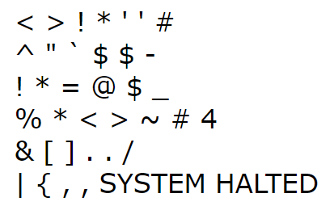

# Programmer's Poem

**IEEEXtreme 17.0** · Time limit: 1000 ms · Memory limit: 256 MB

**CS Academy:** <https://csacademy.com/ieeextreme-practice/task/Poetry/>

## Programmer's Poem



The poem above is meant to be read:

Waka waka bang splat tick tick hash

Caret quote back tick dollar dollar dash

Bang splat equal at dollar underscore

Percent splat waka waka tilde number four

Ampersand bracket bracket dot dot slash

Vertical bar curly bracket comma comma CRASH

## Challenge

In this challenge, you need to determine the rhyme scheme used by a passage. A rhyme scheme for a passage with $n$ lines is a string of uppercase letters of length $n$, where the $i^{th}$ letter in the string corresponds to the $i^{th}$ line in the passage.  The rules for creating the string are:

1) The lines that rhyme will be labelled with upper-case letters except for `X`.

2) The first set of lines that rhyme should be labelled with an `A`. The second set are labelled with a `B`, and so on, skipping the letter `X`.

3) Lines that do not rhyme with any other line should be labelled with an `X`.

## Standard input

The input will begin with two space-separated integers $n$ and $m$.

Each of the next $n$ lines will contain a list of space-separated words that rhyme.  The words will consist of lowercase letters only.

Then there will be a blank line.

The next $m$ lines contain the passage to analyze.

## Standard output

Output the rhyme scheme for the passage.

## Constraints and notes

- $1 \le n \le 100$
- $2 \le m \le 50$

Each rhyming group will contain between 1 and 100 words, inclusive.

Each word will be made of between 1 and 15 lower-case letters, inclusive.

No word will appear in more than one group of rhyming words.

Each line of the passage will contain between 1 and 100 words, inclusive.  The passage will contain only upper- and lower-case letters.

Comparisons should ignore case.

Two words should only be treated as rhyming, if they appear in the same list of rhyming words.

A word rhymes with itself, if and only if, it appears in one of the lists of rhyming words.

## Examples

### Example 1

Input:
```
2 6
hash dash crash slash
underscore four

Waka waka bang splat tick tick hash
Caret quote back tick dollar dollar dash
Bang splat equal at dollar underscore
Percent splat waka waka tilde number four
Ampersand bracket bracket dot dot slash
Vertical bar curly bracket comma comma CRASH
```

Output:
```
AABBAA
```

Explanation:

The first set of rhyming words is "hash", "dash", "slash", and "crash" and so these lines get a label `A`.  "underscore" and "four" are the next set of rhyming words, so they get labelled "B".

### Example 2

Input:
```
4 12
placed traced
selected elected
bee connectivity see tree property me
lan span man fan

I think that I shall never see
A graph more lovely than a tree
A tree whose crucial property
Is loop free connectivity
A tree that must be sure to span
So packets can reach every LAN
First the root must be selected
By ID it is elected
Least cost paths from root are traced
In the tree these paths are placed
A mesh is made by folks like me
Then bridges find a spanning tree
```

Output:
```
AAAABBCCDDAA
```

### Example 3

Input:
```
2 4
fight night bright
near fear

In a contest of code a challenge did appear
With problems to solve both far and near
With syntax and loops and logic so bright
We coded away and conquered the fight
```

Output:
```
XXAA
```

Explanation:

Note that even though "appear" and "near" rhyme in reality, these words do not appear together in a list of rhyming words. Therefore, for the purposes of this problem, they are treated as non-rhyming.

### Example 4

Input:
```
1 4
write

For I have proofs to write
And there are programs to write
And miles to go before I sleep
And miles to go before I sleep
```

Output:
```
AAXX
```

Explanation:

The note in the problem statement indicates that a word rhymes with itself, if and only if, it appears in one of the lists of rhyming words.
