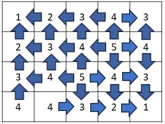
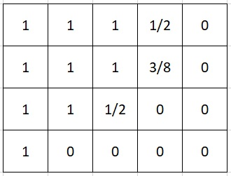

# Watershed

**IEEEXtreme 17.0** · Time limit: 1000 ms · Memory limit: 256 MB

**CS Academy:** <https://csacademy.com/ieeextreme-practice/task/watershed/>

We have been asked to evaluate the drainage of a rectangular region in a nearby town. To do so, we will model the region using a rectangular grid of 1 meter square cells. We have recorded the elevation of each cell, and our model assumes the following:

- Each cell initially contains 1 liter of water.
- Water will flow from cells with higher elevations to adjacent cells with lower elevation.  Two cells are adjacent if they share a border, and therefore a cell can have at most 4 adjacent cells.
- When a cell has more than one adjacent cell with lower elevation, the water is equally split between these adjacent cells.
- No water will flow into or out of the rectangular region.
- If water cannot flow out of a cell, we will put a drain in the cell.

What is the maximum amount of water that will be collected by a drain.

## Standard Input

The first line contains two space-separated integers $n$ and $m$, giving the number of rows and columns in the rectangular region.

The next $n$ lines give the elevations in each of the cells of the grid.  Each line will contain $m$ integers.

## Standard Output

Output the maximum number of liters of water that can flow through a drain. Your output should be within $10^{-4}$ of the exact answer.

## Constraints and notes

- $1 \leq n$
- $1 \leq m$
- $1 \leq n \times m \leq 10^5$

Each elevation value will be a non-negative integer less than or equal to $10^9$.

## Examples

### Example 1

Input:
```
3 3
3 2 3
2 1 2
3 2 3
```

Output:
```
9.000000
```

Explanation:

All of the cells drain towards the center square, so the total volume of water collected by the drain is 9 liters.

### Example 2

Input:
```
3 3
3 3 3
3 3 3
3 3 3
```

Output:
```
1.000000
```

Explanation:

Since all cells are at the same elevation, no cell drains into another one.  Therefore, the maximum water collected by any drain is 1 liter.

### Example 3

Input:
```
4 5
1 2 3 4 3
2 3 4 5 4
3 4 5 4 3
4 4 3 2 1
```

Output:
```
10.375000
```

Explanation:

The table below shows the direction that water flows from each cell.



Based on this flow, the table below shows the contribution of each cell to the drianage in the top left corner.



Note that some cells have their flow split in multiple directions.  For example, the lowest cell with an elevation of 5 has its flow split 4 ways, 2 of which flow towards the upper left corner.  Thus, it contributes 1/2 liter to the top left corner.  The other cell with elevation 5 also has its flow split 4 ways.  1/4 of the flow goes to the left and eventually to the top left corner.  Another 1/4 of the flow goes up, and then splits again, with 1/2 of the 1/4 going to the left and making its way to the top left corner. Thus, this cell contributes 3/8 liter to the top left cell.
