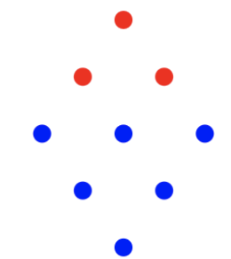
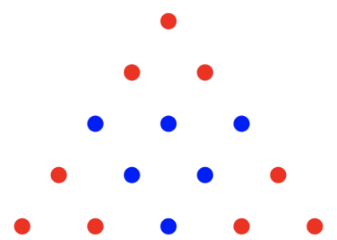
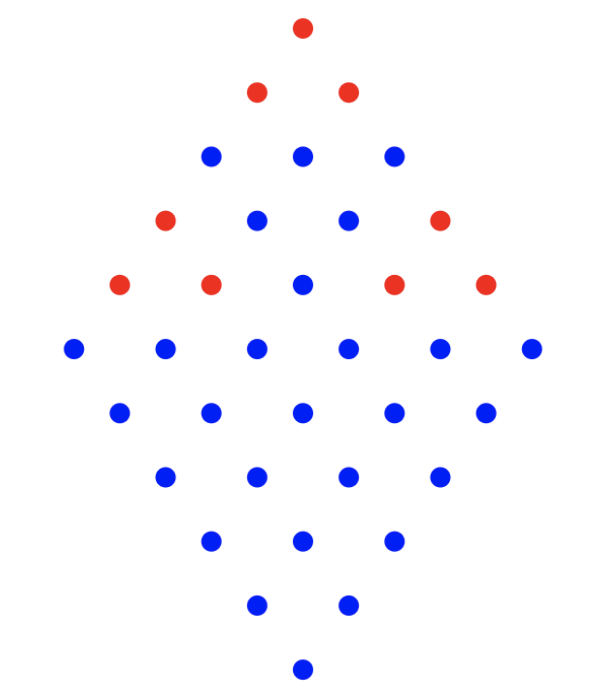
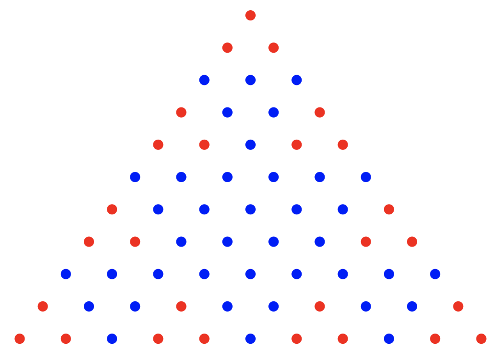

# Sierpinski

**IEEEXtreme 18.0** · Time limit: 1000 ms · Memory limit: 256 MB

**CS Academy:** <https://csacademy.com/ieeextreme-practice/task/sierpinski/>

Waclaw was playing with red and blue points, and he has come up with a very peculiar way of building triangles made up of points. The whole process is incremental, and done in steps.

- At step 1, Waclaw builds a triangle made up of $3$ *red* points. We define the size of the triangle as being the number of points on each side, so in the case of this triangle the size is equal to $2$.
- The next steps follow an inductive principle. At step $N + 1$, Waclaw starts off with a triangle from step $N$ having size $L$, adds to the bottom of it an inverted triangle of size $L + 1$ consisting of *blue* points, and then makes two other copies of the triangle from step $N$ and adds them to the left and right of the inverted blue triangle.



/Step 2 results in building a triangle of size 5/



/Step 3 results in building a triangle of size 11/

Waclaw has come up with a way to identify points using two coordinates $(x, y)$, corresponding to the $y$-th point (from left to right) on the $x$-th line (from top to bottom). You need to answer $Q$ queries of the type:

- Give a pair of coordinates $(x, y)$, find the color of the point at those coordinates.

## Standard input

The first line contains a single integer $Q$.

Each of the next $Q$ line contains two integers $x$ and $y$ corresponding to a query.

## Standard output

For each of the $Q$ queries print the answer on a line: $1$ if the point is red, $0$ if it's blue.

## Constraints and notes

- $1 \leq Q \leq 10^5$
- $1 \leq y \leq x \leq 10^9$
- Waclaw builds a triangle of step $30$, so it's guaranteed all the points from the input exist.

## Examples

### Example 1

Input:
```
6
1 1
5 3
8 2
8 6
5 4
6 4
```

Output:
```
1
0
1
0
1
0
```
